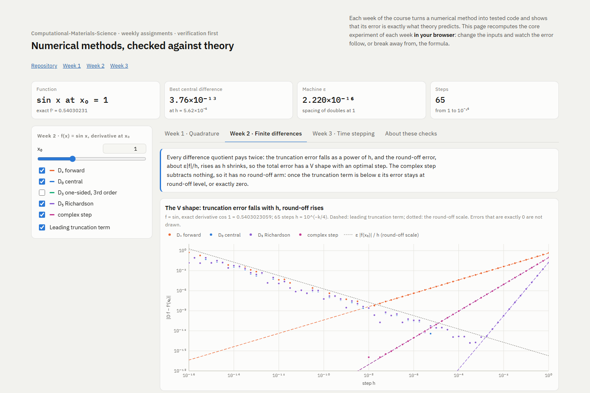

# Computational Materials Science

[](https://github.com/Shuruyue/Computational-Materials-Science/actions/workflows/ci.yml)


**[Interactive page](https://shuruyue.github.io/Computational-Materials-Science/web/numerical-methods.html)**: recompute the core experiment of each week in the browser, from quadrature errors against their exact formulas and the V-shaped error of finite differences to forward Euler exploding on a stiff problem and explicit diffusion breaking down just above r = ½. The error always does what theory says: Simpson's rule falls from order 4 to 1.5 for √x, the central difference bottoms out at 3.8×10⁻¹³ near h = 5.6×10⁻⁶ before round-off takes over, forward Euler at hλ = −2.05 amplifies its truncation error to 10³⁷, and FTCS at r = 0.51 passes an error of 1 after 187 steps while r = 1/6 with the right starting value reaches fourth order.

[](https://shuruyue.github.io/Computational-Materials-Science/web/numerical-methods.html)

Weekly programming assignments for a course in computational materials science. Each week a numerical method is written as tested code and shown to be correct against theory (**verification**: exact error formulas, closed forms, exact discrete solutions, high-precision reruns), then applied to a materials problem and compared with experiment or literature data (**validation**).

Python 3 with NumPy, SciPy and Matplotlib. Every core algorithm is written from scratch; library routines are used only for comparison.

## Weeks

| Week | Topic | Key results |
|---|---|---|
| [week01](week01/) | Convergence of numerical quadrature; Debye heat capacity of Cu | Observed orders 2.000 / 4.000 for the trapezoid / Simpson rules; the error for √x matches its exact error formula to a relative 10⁻⁹, and for e^{cos x} down to round-off; with the electronic heat capacity included, C_p of Cu at 298 K is only −0.6% from experiment |
| [week02](week02/) | The V-shaped error of finite differences and the optimal step; bulk modulus of Cu | Every finite-difference error equals the exact truncation series plus round-off, and the round-off stays inside the textbook bound; the complex step has no round-off arm (zero error for h ≤ 10⁻⁸ in this run); the optimal step for the Debye U(T), 3×10⁻⁴ K, is set by its characteristic scale of 63.5 K; B of Cu is 139.63 GPa, and with 10⁻⁵ eV of noise in the energy the best strain is about 1.2% |
| [week03](week03/) | Tridiagonal and conjugate-gradient solvers; explicit vs implicit time stepping; the stiff Robertson reaction | The Thomas solution of 1D Poisson matches the exact discrete error formula, with the round-off minimum at h ≈ 1.5×10⁻⁵; CG iterations grow ∝ m (about 3(m + 1)), and error/h² is predicted to 5 digits by the error equation; a 40-digit rerun shows that the 10³⁷ of forward Euler is amplified truncation error, not round-off; the Robertson reference solution matches the literature to 10 digits, and BDF at default tolerances reports success while returning y₁ = −2×10⁶ |
| [week04](week04/) | Explicit diffusion (FTCS) and its stability limit; carburizing of steel | With the corner c₀⁰ = Cₛ the numerical solution is the exact one half a step later, which keeps FTCS second order even at r = 1/6; with the mean corner the slope is 4.000; r = 0.51 blows up after 187 steps, and the measured growth converges to the von Neumann factor of the fixed-end grid; as r → 0 the error approaches that of the method of lines solved exactly in time; a 1.0 mm case at 925 °C takes 6.02 h, and the boost–diffuse run matches the superposition solution within one step (6.373 h) |

Each week's README lists the tasks, the key results, a validation table (every value next to its independent check) and where the results differ from the course's reference solution.

## Repository layout

```text
Computational-Materials-Science/
├── environment.yml          # conda environment "cms"
├── web/                     # interactive page (GitHub Pages) and its check against the weekly modules
└── weekNN/                  # one folder per week, all with the same structure
    ├── README.md            # tasks, key results, validation table, figures
    └── work/
        ├── *.py             # modules
        ├── test_*.py        # pytest suite
        ├── labNN.ipynb      # executed notebook: every number and figure
        ├── labNN.html       # the same notebook as a web page
        └── figures/
```

Later weeks import earlier weeks' code (week02 reuses the Simpson rule and Debye C_V of week01), so clone the whole repository.

## Quick start

```bash
git clone https://github.com/Shuruyue/Computational-Materials-Science.git
cd Computational-Materials-Science
conda env create -f environment.yml   # once
conda activate cms
cd week01/work                        # or any other week
pytest -q                             # automated tests
jupyter lab lab01.ipynb               # Run All reproduces every number and figure
```

To read the results without running anything, open `lab*.ipynb` on GitHub (outputs included), or download `lab*.html` and open it in a browser.

## Tests

| Week | Tests | What they check besides the assignment's acceptance criteria |
|---|---|---|
| week01 | 40 | exact error formulas for sin x, √x and e^{cos x}; Debye limits up to u⁶ |
| week02 | 88 | every finite-difference error against its exact truncation series and the round-off bound; series solutions of the Debye U(T) |
| week03 | 70 | exact discrete solutions (Poisson, CVD, DST); exact Hilbert inverse; 40-digit reruns of the time steppers |
| week04 | 48 | the residual of the diffusion equation against its exact truncation error; the hand table of the lecture notes; exact scale invariance; r = ½ against the coarse r = ¼ grid; the method-of-lines limit; superposition for the two-stage process |

## Reproducibility

Results set by truncation error (orders, exact error formulas, closed forms, physical values, the 40-digit reruns) reproduce to every printed digit on other machines. Results set by round-off depend on the NumPy / LAPACK build and the CPU, and are quoted as the values of this run: the left arm of each V, the complex-step error of 0 (one unit in the last place on other builds), the D₀ round-off slope (−1.009 in this run, −1.038 on another build) and the error of the Hilbert solve at n = 12 (24% in this run; 28% and 70% on other builds). The tests check these only against their bounds, so they pass on any platform. The notebooks were run with Python 3.12 from conda-forge ([environment.yml](environment.yml)); CI runs the tests and the page check on every push.

## Not included

The course handouts, textbook page lists, assignment statements, reference solutions and starter code, as well as the textbooks and papers, stay local. The notebooks sometimes compare with the course's reference solution, called "05"; it is not part of this repository.

## License

[MIT](LICENSE)
