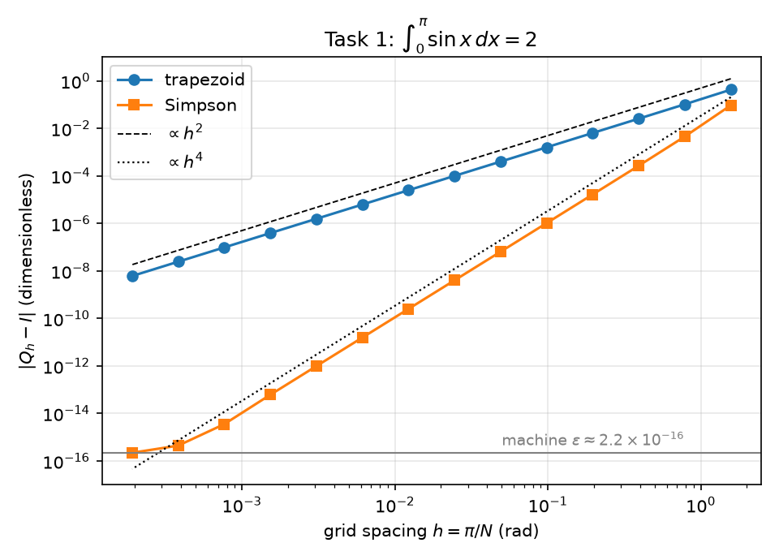
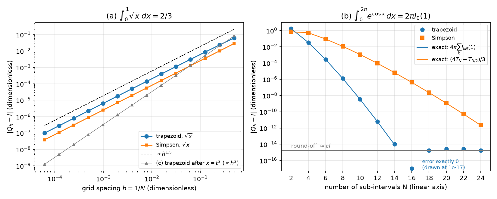
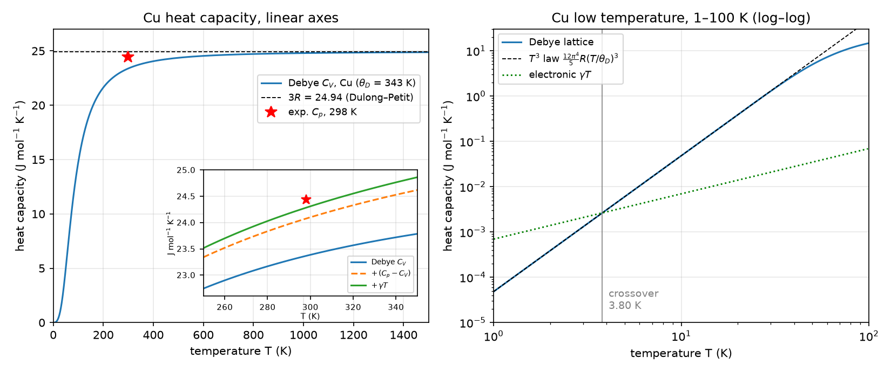

# Week 1: Numerical quadrature and the Debye heat capacity of Cu

The trapezoid and Simpson rules are written and tested, and their convergence is checked against exact error formulas (code verification). Richardson extrapolation then estimates the error of a quantity with no known exact value (solution verification), and the Debye model of the heat capacity of copper is compared with experiment (validation).

The executed notebook [`work/lab01.ipynb`](work/lab01.ipynb) shows every number and figure; [`work/lab01.html`](work/lab01.html) is the same notebook as a web page.

## Tasks

| Task | What is done | Checked against |
|---|---|---|
| 0 | Quadrature tools: trapezoid and Simpson rules, two- and three-grid observed order, Richardson extrapolation, log–log slope fit | 40 pytest checks: the assignment's acceptance criteria plus exact error formulas |
| 1 | ∫₀^π sin x dx for N = 2 … 16384: observed orders and error constants | the exact error series of T_N = (π/N) cot(π/2N) |
| 2 | Where the theoretical order fails: √x on [0, 1], e^{cos x} over one period, and √x after the substitution x = t² | T_h − I = ζ(−½) h^{3/2} + h²/24; T_N − I = 4π Σ I_{kN}(1) |
| 3 | C_V of Cu at 100 K from the trapezoid rule with N = 8, 16, 32: observed order and Richardson extrapolation | Simpson's rule with N = 4096 as referee |
| 4 | C_V(T) of Cu for 1–1500 K; high- and low-temperature limits; electronic term γT | asymptotic series to u⁶; the T³ law; experimental C_p at 298.15 K |

## Key results

- **Code verification.** For sin x the fitted orders are 2.0006 (trapezoid) and 4.0044 (Simpson) over N = 8–256, and the error constants approach (T − I)/h² → −1/6 and (S − I)/h⁴ → 1/90. Every trapezoid error agrees with the exact error series to round-off.
- **√x: the asymptotic order is exactly 1.5.** The error is ζ(−½) h^{3/2} + h²/24, which the program matches to a relative 10⁻⁹ for N ≥ 256. The second term makes the finite-N trapezoid slope 1.4950, and the same fit applied to the formula gives the same value; Simpson's rule removes the h² term and gives a clean 1.5000.
- **e^{cos x}: faster than exponential.** The trapezoid error is 4π Σ I_{kN}(1) ≈ 4π (1/2)^N / N!, a curve that bends downward on a semi-log plot. Simpson's rule is worse, because S_N − I ≈ −(T_{N/2} − I)/3: with N intervals it is only as accurate as the trapezoid rule with N/2.
- **Solution verification.** From the trapezoid rule with N = 8, 16, 32: p_obs = 1.998 and Q* = 14.766136, which differs from the referee value by 2.9×10⁻⁷. With p = 2, Q* is exactly Simpson's rule with N = 32.
- **Validation.** C_V(298.15 K) = 23.37 J mol⁻¹ K⁻¹. Adding C_p − C_V = 0.71 and the electronic term γT = 0.21 gives 24.28, −0.6% from the experimental 24.44. The lattice and electronic terms cross at 3.80 K.

## Validation

Each value of this run next to an independent check: a theoretical value, a closed form or exact error formula, a finer grid, or experiment (validation rows only). `Rel. diff` is |this run − check| / |check|.

| Task | Quantity | This run | Check | Check from | Rel. diff |
|---|---|---|---|---|---|
| 1 | trapezoid e, N=8 | −0.0257683981 | −0.0257683981 | exact series | 6.7×10⁻¹⁶ |
| 1 | Simpson e, N=16 | 1.65910479×10⁻⁵ | 1.65910479×10⁻⁵ | exact series | 1.1×10⁻¹² |
| 1 | (T-I)/h^2, N=256 | −0.166667085 | −0.166666667 | theory limit | 2.5×10⁻⁶ |
| 2a | fitted slope trapezoid (N>=32) | 1.49498591 | 1.49498587 | fit on formula | 2.7×10⁻⁸ |
| 2a | trapezoid e, N=1024 | −6.30444768×10⁻⁶ | −6.30444768×10⁻⁶ | zeta formula | 7.2×10⁻¹¹ |
| 2b | trapezoid \|e\|, N=8 | 1.25168893×10⁻⁶ | 1.25168893×10⁻⁶ | exact formula | 4.1×10⁻¹⁰ |
| 2b | Simpson \|e\|, N=8 | 0.0114639707 | 0.0114639707 | exact formula | 1.2×10⁻¹³ |
| 2c | Simpson max \|e\| | 0 | 0 | exact | 0\* |
| 3 | Richardson Q\* | 14.7661357 | 14.7661354 | referee | 2.0×10⁻⁸ |
| 3 | error estimate \|Q\*-Q3\| | 0.00084321339 | 0.000843506459 | actual error | 3.5×10⁻⁴ |
| 4 | C\_V(1500 K)/3R | 0.997390452 | 0.997390452 | series to u^6 | 1.2×10⁻¹¹ |
| 4 | lattice C\_V, 10 K | 0.0481684373 | 0.0481684373 | T^3 law | 7.6×10⁻¹¹ |
| 4 | crossover T [K] | 3.79849119 | 3.79849119 | T^3 closed form | 1.2×10⁻¹⁶ |
| 4 | Debye + dC + gamma\*T, 298.15 K | 24.2847594 | 24.44 | experiment | 6.4×10⁻³ |

<details>
<summary>Full summary table (48 rows, as printed at the end of the notebook)</summary>

`05` is the value printed in the course's reference solution (not included in this repository). A `*` in `Rel. diff` means the check value is 0 and the absolute value is shown.

| Task | Quantity | This run | Check | Check from | Rel. diff | 05 |
|---|---|---|---|---|---|---|
| 1 | fitted slope trapezoid (N=8-256) | 2.0006137 | 2 | theory order | 3.1×10⁻⁴ | 2.001 |
| 1 | fitted slope Simpson (N=8-256) | 4.00440209 | 4 | theory order | 1.1×10⁻³ | 4.004 |
| 1 | trapezoid e, N=4 | −0.103881102 | −0.103881102 | exact series | 8.0×10⁻¹⁶ | -0.1039 |
| 1 | trapezoid e, N=8 | −0.0257683981 | −0.0257683981 | exact series | 6.7×10⁻¹⁶ | -0.02577 |
| 1 | Simpson e, N=2 | 0.0943951024 | 0.0943951024 | exact series | 2.4×10⁻¹⁵ | +0.0944 |
| 1 | Simpson e, N=16 | 1.65910479×10⁻⁵ | 1.65910479×10⁻⁵ | exact series | 1.1×10⁻¹² | +1.66e-5 |
| 1 | (T-I)/h^2, N=256 | −0.166667085 | −0.166666667 | theory limit | 2.5×10⁻⁶ | -0.166667 |
| 1 | (S-I)/h^4, N=256 | 0.0111113053 | 0.0111111111 | theory limit | 1.7×10⁻⁵ | - |
| 1 | Simpson e, N=4096 (round-off) | 3.55271368×10⁻¹⁵ | 3.84518483×10⁻¹⁵ | exact series | 7.6×10⁻² | ~3.6e-15 |
| 1 | trapezoid e, N=16384 | −6.12785711×10⁻⁹ | −6.12785692×10⁻⁹ | exact series | 3.0×10⁻⁸ | 6.1e-9 |
| 2a | fitted slope trapezoid (N>=32) | 1.49498591 | 1.49498587 | fit on formula | 2.7×10⁻⁸ | 1.495 |
| 2a | fitted slope Simpson (N>=32) | 1.4999996 | 1.5 | theory order | 2.7×10⁻⁷ | 1.500 |
| 2a | trapezoid e, N=1024 | −6.30444768×10⁻⁶ | −6.30444768×10⁻⁶ | zeta formula | 7.2×10⁻¹¹ | -6.3e-6 |
| 2a | Simpson e, N=1024 | −2.47755801×10⁻⁶ | −2.47755801×10⁻⁶ | zeta formula | 7.8×10⁻¹⁰ | -2.5e-6 |
| 2b | trapezoid \|e\|, N=4 | 0.0343969188 | 0.0343969188 | exact formula | 2.5×10⁻¹⁴ | 3.4e-2 |
| 2b | Simpson \|e\|, N=4 | 0.534315792 | 0.534315792 | exact formula | 4.2×10⁻¹⁶ | 5.3e-1 |
| 2b | trapezoid \|e\|, N=8 | 1.25168893×10⁻⁶ | 1.25168893×10⁻⁶ | exact formula | 4.1×10⁻¹⁰ | 1.3e-6 |
| 2b | Simpson \|e\|, N=8 | 0.0114639707 | 0.0114639707 | exact formula | 1.2×10⁻¹³ | 1.2e-2 |
| 2b | trapezoid \|e\|, N=12 | 6.52899956×10⁻¹² | 6.52918603×10⁻¹² | exact formula | 2.9×10⁻⁵ | 6.5e-12 |
| 2b | Simpson \|e\|, N=12 | 9.42002784×10⁻⁵ | 9.42002784×10⁻⁵ | exact formula | 1.2×10⁻¹¹ | 9.4e-5 |
| 2b | trapezoid \|e\|, N=14 (round-off) | 1.0658141×10⁻¹⁴ |  |  |  | 1.1e-14 |
| 2b | Simpson \|e\|, N=14 | 6.69878965×10⁻⁶ | 6.69878965×10⁻⁶ | exact formula | 4.7×10⁻¹⁰ | 6.7e-6 |
| 2b | Simpson \|e\|, N=24 | 2.17603713×10⁻¹² | 2.17639534×10⁻¹² | exact formula | 1.6×10⁻⁴ | 2.2e-12 |
| 2b | trapezoid max \|e\|, N=18-24 | 2.66453526×10⁻¹⁵ |  |  |  | &lt;1e-15 |
| 2b | round-off level eps\*I | 1.76634852×10⁻¹⁵ |  |  |  | - |
| 2c | trapezoid fitted slope | 2 | 2 | theory order | 1.4×10⁻⁹ | 2.000 |
| 2c | (T-I)/h^2, N=256 | 0.333333333 | 0.333333333 | theory limit | 7.3×10⁻¹² | +1/3 |
| 2c | Simpson max \|e\| | 0 | 0 | exact | 0\* | 0 |
| 3 | Q1 (trapezoid N=8) | 14.7796137 |  |  |  | 14.779614 |
| 3 | Q2 (trapezoid N=16) | 14.7695085 |  |  |  | 14.769509 |
| 3 | Q3 (trapezoid N=32) | 14.7669789 |  |  |  | 14.766979 |
| 3 | p\_obs | 1.9980879 | 2 | theory order | 9.6×10⁻⁴ | 1.998 |
| 3 | Richardson Q\* | 14.7661357 | 14.7661354 | referee | 2.0×10⁻⁸ | 14.766136 |
| 3 | error estimate \|Q\*-Q3\| | 0.00084321339 | 0.000843506459 | actual error | 3.5×10⁻⁴ | 8.4e-4 |
| 3 | \|Q\* - referee\| | 2.93069235×10⁻⁷ |  |  |  | ~1e-6 |
| 3 | referee Simpson N=4096 | 14.7661354 | 14.7661354 | Simpson N=8192 | 0 | 14.766135 |
| 4 | C\_V(1500 K)/3R | 0.997390452 | 0.997390452 | series to u^6 | 1.2×10⁻¹¹ | 0.9974 |
| 4 | 1-u^2/20 at 1500 K | 0.997385578 |  |  |  | 0.9974 |
| 4 | C\_V(5 K)/T^3 law | 1 | 1 | theory limit | 0 | 1.000000 |
| 4 | C\_V(298.15 K), N=2048 | 23.3677288 | 23.3677288 | N=4096 | 1.8×10⁻¹⁵ | 23.37 |
| 4 | C\_p - C\_V at 298.15 K | 0.709816332 |  |  |  | ~0.7 (given) |
| 4 | Debye C\_V + 0.7 at 298.15 K | 24.0677288 | 24.44 | experiment | 1.5×10⁻² | 24.07 |
| 4 | Debye + dC + gamma\*T, 298.15 K | 24.2847594 | 24.44 | experiment | 6.4×10⁻³ | - |
| 4 | lattice C\_V, 10 K | 0.0481684373 | 0.0481684373 | T^3 law | 7.6×10⁻¹¹ | 4.82e-2 |
| 4 | electronic share, 10 K | 0.126092109 |  |  |  | 13% |
| 4 | lattice C\_V, 2 K | 0.000385347499 | 0.000385347499 | T^3 law | 0 | 3.85e-4 |
| 4 | electronic share, 2 K | 0.782945311 |  |  |  | 78% |
| 4 | crossover T [K] | 3.79849119 | 3.79849119 | T^3 closed form | 1.2×10⁻¹⁶ | ~4 |

</details>

## Differences from the course's reference solution

Most values of the course's reference solution agree with this run to the digits they give. The last section of the notebook lists, with numbers, the few places where they differ. In short:

- The asymptotic trapezoid order for √x is exactly 1.5; a slope of 1.495 is what a fit at finite N gives.
- The error for e^{cos x} bends downward on a semi-log plot (super-exponential convergence); it is not a straight line.
- At 298 K, adding the electronic heat capacity γT = 0.21 J mol⁻¹ K⁻¹ brings the Debye model to −0.6% from experiment instead of −1.5%.

## Figures



*Task 1: error of the trapezoid and Simpson rules for ∫₀^π sin x dx against h = π/N, with h² and h⁴ reference lines. Simpson's rule reaches the round-off level near machine ε.*



*Task 2. (a) √x: both rules converge as h^{1.5}; after the substitution x = t² the trapezoid rule is back to h². (b) e^{cos x} over one period: the trapezoid error falls faster than exponentially, on the exact formula 4π Σ I_{kN}(1), while Simpson's rule lags behind, on (4T_N − T_{N/2})/3. The error that is exactly 0 at N = 16 is drawn at 10⁻¹⁷.*



*Task 4. Left: Debye C_V of Cu from 1 to 1500 K, approaching the Dulong–Petit value 3R; the inset adds C_p − C_V and γT near 298 K, against the experimental C_p. Right: below 100 K the lattice term follows the T³ law and crosses the electronic term γT at 3.80 K.*

## Files

| File | Contents |
|---|---|
| `work/quadrature.py` | `trapezoid`, `simpson`, `observed_order`, `observed_order_3grid`, `richardson`, `fit_slope` |
| `work/debye.py` | Debye integrand (x → 0 and overflow handled), `debye_cv`, high- and low-temperature limits |
| `work/test_quadrature.py`, `work/test_debye.py` | 40 tests |
| `work/lab01.ipynb`, `work/lab01.html` | the executed notebook |
| `work/figures/` | the three figures above |

## Run

```bash
conda activate cms
cd week01/work
pytest -q
jupyter lab lab01.ipynb   # Run All
```
