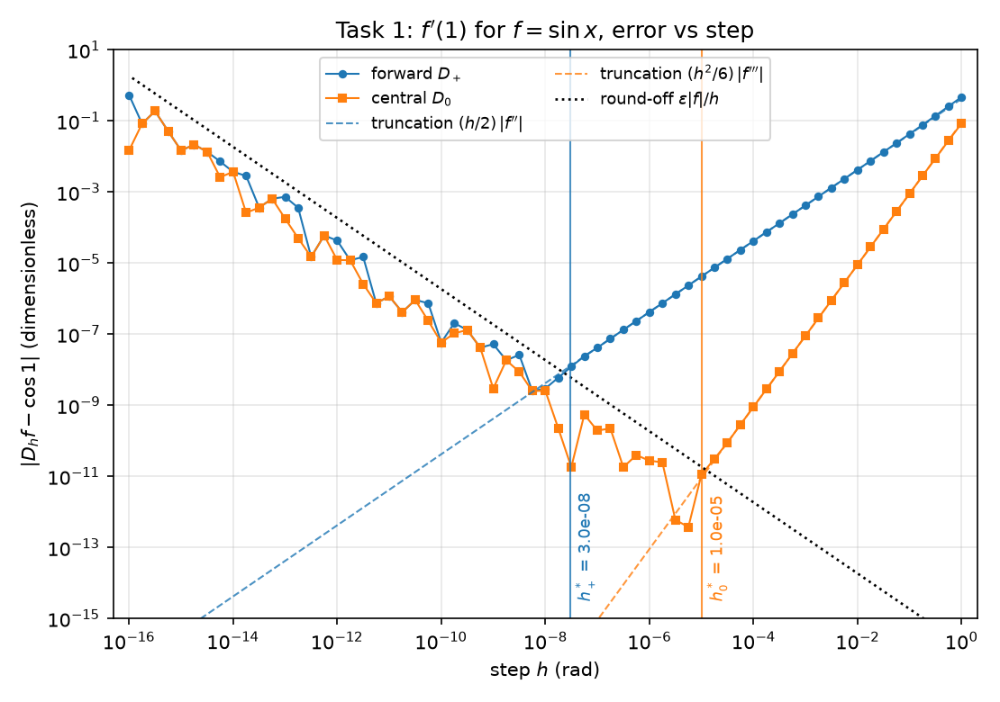
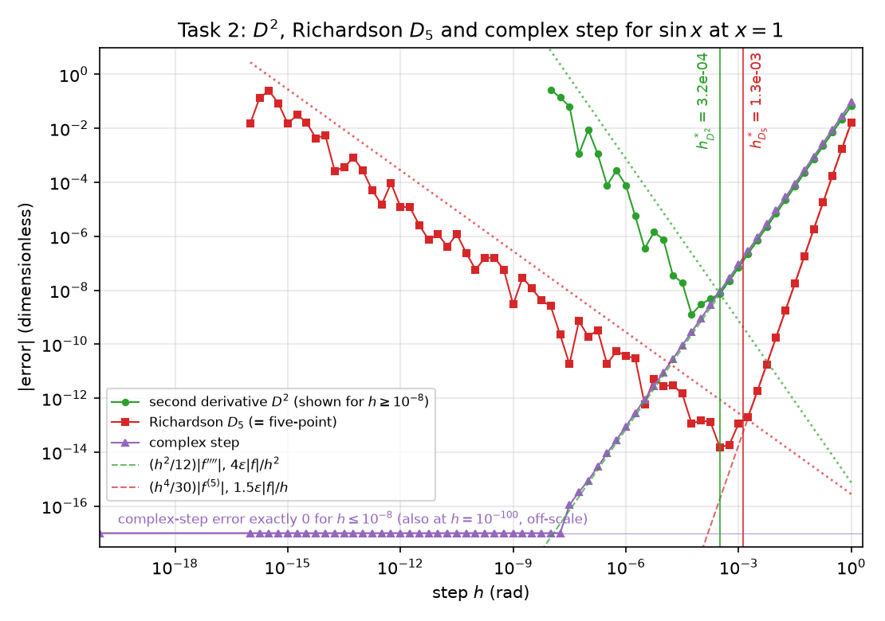
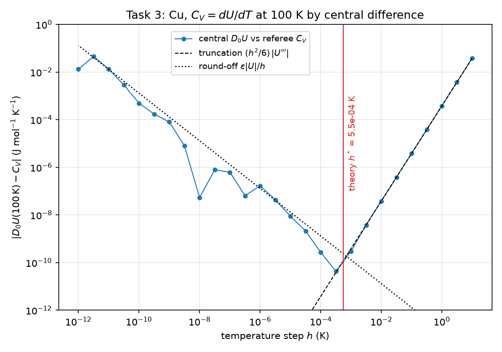
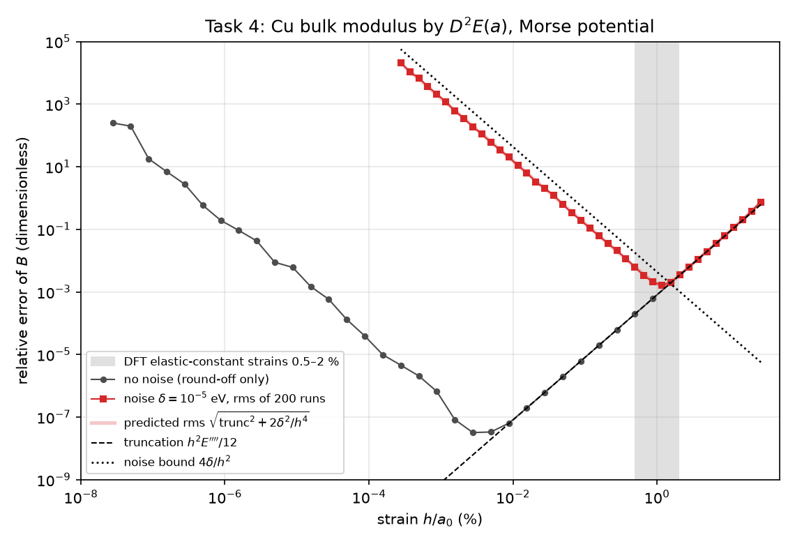

# Week 2: The V-shaped error of finite differences, the optimal step, and the bulk modulus of Cu

Finite-difference derivatives trade truncation error (large h) against round-off error (small h), which gives the V-shaped error curve. This week every finite-difference error is split exactly into its truncation part and its round-off part, the optimal step is predicted from theory, and the same ideas are applied to the heat capacity C_V = dU/dT of Cu and to its bulk modulus from a Morse potential, with and without noise in the energy.

The executed notebook [`work/lab02.ipynb`](work/lab02.ipynb) shows every number and figure; [`work/lab02.html`](work/lab02.html) is the same notebook as a web page.

## Tasks

| Task | What is done | Checked against |
|---|---|---|
| 0 | Floating point: machine ε by a loop, spacing of doubles, cancellation in (1 − cos x)/x² and in the small root of x² − 10⁸x + 1 | `np.finfo`, powers of 2, Taylor series |
| 1 | D₊, D₋, D₀, D₃ for f′(1), f = sin x, over 65 steps from 1 to 10⁻¹⁶: the V shape, its slopes and its minimum | the exact truncation series of each stencil; the round-off bound Kε\|f\|/h^m |
| 2 | Second difference D², Richardson D₅ and the complex step | exact truncation series; closed form of the complex-step error |
| 3 | C_V = dU/dT of Cu at 100 K from a Debye U(T) computed by quadrature: three steps, Richardson, optimal step | a series solution of U, C_V and dC_V/dT without quadrature |
| 4 | Bulk modulus of Cu from E(a) of a Morse potential: equilibrium, D² without and with noise, comparison with experiment, re-selected neighbours | analytic derivatives and the complex step; the sinh closed form of the D² truncation error; the predicted rms |

## Key results

- **Floating point.** ε = 2.220446×10⁻¹⁶ after 52 halvings. At x = 10⁻⁸, (1 − cos x)/x² computed directly gives 0 and the rewritten 2 sin²(x/2)/x² gives 0.5; the direct small root of x² − 10⁸x + 1 is exactly 2⁻²⁷, 25.5% off.
- **The V shape, split exactly.** For every stencil the program's error minus the exact truncation series is the round-off itself, and it stays inside the bound of the lecture notes (at most 24% of it for D₊ and 38% for D₀). The smallest D₀ error is 3.8×10⁻¹³ at h = 5.6×10⁻⁶, near the predicted h* = 1.0×10⁻⁵; h = 10⁻¹² is worse than h = 10⁻².
- **Higher order and the complex step.** D² = −1.1102 at h = 10⁻⁸ is exactly −1 spacing of sin 1 divided by h². D₅ reaches 1.5×10⁻¹⁴, 24 times better than D₀. The complex step has no round-off arm: its error is exactly 0 for every h ≤ 10⁻⁸.
- **C_V of Cu.** U(100 K) = 583.92606 J/mol agrees with the series solution to a relative 4.6×10⁻¹⁴. Three steps give p_obs = 1.9997; Richardson with p = 2 is off by only −1.84×10⁻⁸, as predicted by the next terms of the error series. The best step is 10⁻⁴–10⁻³ K, not 10⁻⁵, because U(T) varies on a scale of x_c = 63.5 K.
- **Bulk modulus of Cu.** a₀ = 3.606407 Å, E(a₀) = −3.542855 eV and B = 139.627 GPa (2778 neighbours). Without noise, D² matches B + the exact truncation error to 11 digits at h = 0.1 Å. With 10⁻⁵ eV of noise in E the best step is 0.042 Å (1.2% strain), equal to the derived rms optimum h*_rms = (12√2 δ/|E⁗|)^{1/4}; at h = 0.001 Å the noise makes B 200% wrong.
- **Validation.** a₀, the cohesive energy and B are within 2% of experiment, but these three quantities were used to fit the potential. The genuine prediction, the vacancy formation energy, is 3.54 eV against about 1.28 eV in experiment: a model error of the pair potential that no choice of step can remove.

## Validation

Each value of this run next to an independent check: a theoretical value, a closed form or exact error series, the complex step, or experiment (validation rows only). Rows marked (mag.) are dominated by round-off and are compared only in order of magnitude; rows marked (bound) are bounds, which the measured value should stay below.

| Task | Quantity | This run | Check | Check from | Rel. diff |
|---|---|---|---|---|---|
| 0 | small root, direct | 7.4505806×10⁻⁹ | 7.4505806×10⁻⁹ | 2^-27 (one spacing/2) | 0 |
| 1a | D3 error, h = 0.1 | 6.8206934×10⁻⁵ | 6.8206934×10⁻⁵ | exact trunc. series | 1.3×10⁻¹¹ |
| 1b | D0 truncation slope | 1.999925 | 1.9999251 | fit to exact series | 4.7×10⁻⁸ |
| 2a | D2 value at h = 1e-8 | −1.110223 | −1.110223 | -1 spacing / h^2 | 2.0×10⁻¹⁶ |
| 2c | complex-step max \|err\|, h&lt;=1e-8 | 0 | 0 | exact (no cancellation) | 0\* |
| 3 | U(100 K) (J/mol) | 583.92606 | 583.92606 | series, no quadrature | 4.6×10⁻¹⁴ |
| 3 | Q3 - referee | −0.00038082306 | −0.00038082305 | error series | 9.1×10⁻¹⁰ |
| 3 | Q\* (p=2) - referee | −1.8375646×10⁻⁸ | −1.8376932×10⁻⁸ | -(h^4/30)U5 - ... | 7.0×10⁻⁵ |
| 4a | E''(a0) (eV/Å^2) | 7.0715778 | 7.0715778 | complex step of E' | 0 |
| 4b | B\_FD, h = 0.01 Å | 139.63562 | 139.63562 | B + exact truncation | 2.5×10⁻¹² |
| 4c | best h, delta=1e-5 (Å) | 0.04216965 | 0.042430595 | h\*\_rms formula | 6.1×10⁻³ |
| 4c | rms at h=0.001, delta=1e-5 (GPa) | 280.16941 | 279.23386 | predicted rms | 3.4×10⁻³ |
| 4e | B rebuilt, h = 0.02 Å (GPa) | 140.21456 | 140.21456 | B\_cut + exact trunc. | 1.0×10⁻¹² |
| 4d | B vs exp. 137 GPa | 139.627 | 137 | experiment | 1.9×10⁻² |
| 4d | vacancy E\_v^f vs exp. 1.28 eV | 3.5428546 | 1.28 | experiment | 1.8 |

<details>
<summary>Full summary table (113 rows, as printed at the end of the notebook)</summary>

`05` is the value printed in the course's reference solution (not included in this repository). A `*` in `Rel. diff` means the check value is 0 and the absolute value is shown.

| Task | Quantity | This run | Check | Check from | Rel. diff | 05 |
|---|---|---|---|---|---|---|
| 0 | loop eps (float64) | 2.220446×10⁻¹⁶ | 2.220446×10⁻¹⁶ | np.finfo | 0 | 2.220446049250313e-16 |
| 0 | halvings (float64) | 52 | 52 | theory (52 bits) | 0 | 52 |
| 0 | loop eps (float32) | 1.1920929×10⁻⁷ | 1.1920929×10⁻⁷ | 2^-23 | 0 | 1.1920929e-07 |
| 0 | np.spacing(1e3) | 1.1368684×10⁻¹³ | 1.1368684×10⁻¹³ | 2^(9-52) | 0 | 1.14e-13 |
| 0 | np.spacing(1e6) | 1.1641532×10⁻¹⁰ | 1.1641532×10⁻¹⁰ | 2^(19-52) | 0 | 1.16e-10 |
| 0 | np.spacing(1e16) | 2 | 2 | 2^(53-52) | 0 | 2.0 |
| 0 | (1-cos x)/x^2 direct, x=1e-8 | 0 | 0 | cos x rounds to 1 | 0\* | 0 |
| 0 | (1-cos x)/x^2 rewritten, x=1e-8 | 0.5 | 0.5 | Taylor series | 0 | 0.5 |
| 0 | rel. diff at x = 1e-4 | 5.2441378×10⁻⁹ |  |  |  | 5e-9 (mag.) |
| 0 | rel. diff at x = 1e-6 | 8.8900582×10⁻⁵ |  |  |  | 9e-5 (mag.) |
| 0 | small root, direct | 7.4505806×10⁻⁹ | 7.4505806×10⁻⁹ | 2^-27 (one spacing/2) | 0 | 7.450580596923828e-09 |
| 0 | small root, c / large root | 1×10⁻⁸ | 1×10⁻⁸ | exact 1e-8(1+1e-16) | 0 | 1.0e-08 |
| 0 | rel. diff of the two roots | 0.25494194 | 0.25494194 | 1 - 2^-27/1e-8 | 0 | 25.5 % |
| 1a | D+ error, h = 0.1 | −0.042938553 | −0.042938553 | exact trunc. series | 1.7×10⁻¹⁴ | -4.2939e-02 |
| 1a | D- error, h = 0.1 | 0.041138446 | 0.041138446 | exact trunc. series | 7.9×10⁻¹⁵ | +4.1138e-02 |
| 1a | D0 error, h = 0.1 | −0.0009000537 | −0.0009000537 | exact trunc. series | 2.3×10⁻¹³ | -9.0005e-04 |
| 1a | D3 error, h = 0.1 | 6.8206934×10⁻⁵ | 6.8206934×10⁻⁵ | exact trunc. series | 1.3×10⁻¹¹ | +6.8207e-05 |
| 1a | D0 error, h = 0.001 | −9.005045×10⁻⁸ | −9.005038×10⁻⁸ | exact trunc. series | 7.8×10⁻⁷ | -9.0050e-08 |
| 1a | D3 error, h = 0.001 | 6.9979467×10⁻¹¹ | 7.010456×10⁻¹¹ | exact trunc. series | 1.8×10⁻³ | +6.9979e-11 |
| 1b | D+ truncation slope | 1.0037366 | 1.0037366 | fit to exact series | 2.5×10⁻¹¹ | 1.004 |
| 1b | D0 truncation slope | 1.999925 | 1.9999251 | fit to exact series | 4.7×10⁻⁸ | 2.000 |
| 1b | D+ round-off slope | −1.0916034 | −1 | model eps\|f\|/h | 9.2×10⁻² | -1.09 |
| 1b | D0 round-off slope | −1.0088636 | −1 | model eps\|f\|/h | 8.9×10⁻³ | -1.04 |
| 1c | D+ best h | 5.6234133×10⁻⁹ | 2.9802322×10⁻⁸ | theory h\* (mag.) | 8.1×10⁻¹ | 5.6e-09 |
| 1c | D+ min \|error\| | 2.5267106×10⁻⁹ | 2.507779×10⁻⁸ | theory e\* (bound) | 9.0×10⁻¹ | 2.5e-09 |
| 1c | D0 best h | 5.6234133×10⁻⁶ | 1.012328×10⁻⁵ | theory h\* (mag.) | 4.4×10⁻¹ | 5.6e-06 |
| 1c | D0 min \|error\| | 3.7636561×10⁻¹³ | 2.7685308×10⁻¹¹ | theory e\* (bound) | 9.9×10⁻¹ | 3.8e-13 |
| 1c | theory h\*, D+ | 2.9802322×10⁻⁸ |  |  |  | 2.98e-08 |
| 1c | theory e\*, D+ | 2.507779×10⁻⁸ |  |  |  | 2.51e-08 |
| 1c | theory h\*, D0 | 1.012328×10⁻⁵ |  |  |  | 1.01e-05 |
| 1c | theory e\*, D0 | 2.7685308×10⁻¹¹ |  |  |  | 2.77e-11 |
| 1c | D0 \|error\|, h = 1e-2 | 9.0049934×10⁻⁶ | 9.0049934×10⁻⁶ | exact trunc. series | 2.6×10⁻¹¹ | 9.0e-06 |
| 1c | D0 \|error\|, h = 1e-12 | 1.2270934×10⁻⁵ | 0.00018684409 | round-off bound | 9.3×10⁻¹ | 1.2e-05 (mag.) |
| 1d | D+ best k (h = 2^-k) | 27 |  |  |  | 27 |
| 1d | D+ min \|error\|, 2^-k | 5.4551075×10⁻¹⁰ |  |  |  | 5e-10 |
| 1d | D0 best k (h = 2^-k) | 17 |  |  |  | 17 |
| 1d | D0 min \|error\|, 2^-k | 1.8607338×10⁻¹³ |  |  |  | 1.9e-13 |
| 1d | D+ min \|error\|, temp trick | 3.1378633×10⁻¹⁰ |  |  |  | 3e-10 |
| 1d | D0 min \|error\|, temp trick | 2.9642955×10⁻¹³ |  |  |  | 3e-13 |
| 2a | D2 truncation slope | 2.0000094 | 1.9999501 | fit to exact series | 3.0×10⁻⁵ | 2.000 |
| 2a | D2 error, h = 0.1 | 0.00070099212 | 0.00070099212 | exact trunc. series | 1.5×10⁻¹¹ | +7.010e-04 |
| 2a | D2 error, h = 0.01 | 7.012235×10⁻⁶ | 7.0122348×10⁻⁶ | exact trunc. series | 2.4×10⁻⁸ | +7.012e-06 |
| 2a | D2 best h | 5.6234133×10⁻⁵ | 0.00032130713 | theory h\* (mag.) | 8.2×10⁻¹ | 5.6e-05 |
| 2a | D2 min \|error\| | 1.2846478×10⁻⁹ | 1.4478669×10⁻⁸ | theory e\* (bound) | 9.1×10⁻¹ | 1.3e-09 |
| 2a | D2 theory h\* | 0.00032130713 |  |  |  | 3.21e-04 |
| 2a | D2 theory e\* | 1.4478669×10⁻⁸ |  |  |  | 1.45e-08 |
| 2a | D2 value at h = 1e-8 | −1.110223 | −1.110223 | -1 spacing / h^2 | 2.0×10⁻¹⁶ | -1.110 |
| 2b | max \|D5 - five-point\| | 3.6970427×10⁻¹⁴ | 0 | identical formulas | 3.7×10⁻¹⁴\* | &lt; 1e-12 |
| 2b | D5 truncation slope | 3.9995304 | 3.9995317 | fit to exact series | 3.1×10⁻⁷ | 4.000 |
| 2b | D5 error, h = 0.1 | −1.7988649×10⁻⁶ | −1.7988649×10⁻⁶ | exact trunc. series | 2.3×10⁻¹⁰ | -1.799e-06 |
| 2b | D5 error, h = 0.01 | −1.8009916×10⁻¹⁰ | −1.8009862×10⁻¹⁰ | exact trunc. series | 3.0×10⁻⁶ | -1.801e-10 |
| 2b | D5 best h | 0.00031622777 | 0.0013121969 | theory h\* (mag.) | 7.6×10⁻¹ | 5.6e-04 |
| 2b | D5 min \|error\| | 1.54321×10⁻¹⁴ | 2.6698178×10⁻¹³ | theory e\* (bound) | 9.4×10⁻¹ | 1.8e-14 |
| 2b | D5 theory h\* | 0.0013121969 |  |  |  | 1.31e-03 |
| 2b | D5 theory e\* | 2.6698178×10⁻¹³ |  |  |  | 2.67e-13 |
| 2c | complex-step slope | 2.0000387 | 2 | theory order | 1.9×10⁻⁵ | 2.000 |
| 2c | complex-step error, h = 0.1 | 0.0009009542 | 0.0009009542 | cos1 (sinh h/h - 1) | 4.2×10⁻¹⁴ | +9.010e-04 |
| 2c | complex-step max \|err\|, h&lt;=1e-8 | 0 | 0 | exact (no cancellation) | 0\* | 0 or 1.1e-16 |
| 3 | U(100 K) (J/mol) | 583.92606 | 583.92606 | series, no quadrature | 4.6×10⁻¹⁴ | 583.92606 |
| 3 | referee C\_V(100 K) | 14.766135 | 14.766135 | series 4U/T - 9Ru/(e^u-1) | 8.4×10⁻¹⁶ | 14.7661353904 |
| 3 | Q1 (h = 4 K) | 14.760043 | 14.760043 | referee + error series | 5.6×10⁻¹² | 14.760043 |
| 3 | Q2 (h = 2 K) | 14.764612 | 14.764612 | referee + error series | 3.6×10⁻¹³ | 14.764612 |
| 3 | Q3 (h = 1 K) | 14.765755 | 14.765755 | referee + error series | 2.4×10⁻¹⁴ | 14.765755 |
| 3 | ratio (Q1-Q2)/(Q2-Q3) | 3.9992724 | 4 | theory 2^p | 1.8×10⁻⁴ | 3.9993 |
| 3 | p\_obs | 1.9997376 | 2 | theory order | 1.3×10⁻⁴ | 1.9997 |
| 3 | Q\* (p = 2) | 14.766135 | 14.766135 | series C\_V | 1.2×10⁻⁹ | 14.7661355 |
| 3 | Q\* (p = p\_obs) | 14.766135 | 14.766135 | series C\_V | 5.0×10⁻⁹ | 14.7661355 |
| 3 | error estimate \|Q\* - Q3\| | 0.00038080468 | 0.00038082306 | actual \|Q3 - referee\| | 4.8×10⁻⁵ | 3.81e-04 |
| 3 | Q3 - referee | −0.00038082306 | −0.00038082305 | error series | 9.1×10⁻¹⁰ | -3.81e-04 |
| 3 | Q\* (p=2) - referee | −1.8375646×10⁻⁸ | −1.8376932×10⁻⁸ | -(h^4/30)U5 - ... | 7.0×10⁻⁵ | 7e-08 (p\_obs) |
| 3 | D0 - referee, h = 1 K | −0.00038082306 | −0.00038082306 | error series | 3.0×10⁻⁹ | -3.81e-04 |
| 3 | D0 - referee, h = 0.1 K | −3.8082764×10⁻⁶ | −3.808276×10⁻⁶ | error series | 1.0×10⁻⁷ | -3.81e-06 |
| 3 | D0 - referee, h = 0.01 K | −3.8082606×10⁻⁸ | −3.8082764×10⁻⁸ | error series | 4.2×10⁻⁶ | -3.81e-08 |
| 3 | U''' by D^2 (h = 1 K) | −0.00228492 | −0.0022849659 | complex step, series | 2.0×10⁻⁵ | -2.285e-03 |
| 3 | x\_c (K) | 63.45935 | 63.458926 | exact derivatives | 6.7×10⁻⁶ | 63.5 |
| 3 | theory h\* (K) | 0.00055422075 |  |  |  | 5.5e-04 |
| 3 | best h on grid (K) | 0.00031622777 | 0.00055422075 | theory h\* (mag.) | 4.3×10⁻¹ | 3e-04 |
| 3 | min \|D0 - referee\| | 4.2755133×10⁻¹¹ | 3.5091874×10⁻¹⁰ | theory e\* (bound) | 8.8×10⁻¹ | 4e-11 |
| 4a | neighbours (0 &lt; \|s\| &lt;= 5.5) | 2778 |  |  |  | 2778 |
| 4a | a0 (Å) | 3.6064073 |  |  |  | 3.606407 |
| 4a | E'(a0) (eV/Å) | 2.7392898×10⁻¹⁴ | 0 | equilibrium | 2.7×10⁻¹⁴\* |  |
| 4a | E(a0) (eV/atom) | −3.5428546 |  |  |  | -3.542855 |
| 4a | E''(a0) (eV/Å^2) | 7.0715778 | 7.0715778 | complex step of E' | 0 | 7.07158 |
| 4a | E''''(a0) (eV/Å^4) | 52.357603 | 52.357603 | complex step of E''' | 0 | 52.358 |
| 4a | B analytic (GPa) | 139.627 |  |  |  | 139.627 |
| 4a | E(a0): \|s\|&lt;=7 minus \|s\|&lt;=5.5 | −1.1441712×10⁻⁸ | −1.1098797×10⁻⁸ | continuum tail estimate | 3.1×10⁻² | ~1.4e-09 |
| 4b | truncation slope | 2.0001829 | 2.0002708 | fit to exact trunc. | 4.4×10⁻⁵ | 2.000 |
| 4b | B\_FD, h = 0.1 Å | 140.49005 | 140.49005 | B + exact truncation | 1.8×10⁻¹⁴ | 140.490 |
| 4b | B\_FD, h = 0.01 Å | 139.63562 | 139.63562 | B + exact truncation | 2.5×10⁻¹² | 139.6356 |
| 4b | (B\_FD - B)/h^2, h = 0.1 | 86.305139 | 86.305139 | exact truncation/h^2 | 2.9×10⁻¹² | 86.31 |
| 4b | (B\_FD - B)/h^2, h = 0.01 | 86.15083 | 86.150826 | exact truncation/h^2 | 4.0×10⁻⁸ | 86.15 |
| 4b | (B\_FD - B)/h^2, h = 0.001 | 86.212809 | 86.149285 | exact truncation/h^2 | 7.4×10⁻⁴ | 86.2 |
| 4b | theory coefficient (GPa/Å^2) | 86.14927 |  |  |  | 86.15 |
| 4b | best h, no noise (Å) | 0.0001 | 0.0001638754 | theory h\* (mag.) | 3.9×10⁻¹ | ~2e-04 |
| 4b | min relative error of B | 3.2036986×10⁻⁸ |  |  |  | ~3e-08 |
| 4c | theory h\* bound, delta=1e-5 (Å) | 0.055025674 |  |  |  | 0.055 |
| 4c | best h, delta=1e-5 (Å) | 0.04216965 | 0.042430595 | h\*\_rms formula | 6.1×10⁻³ | 0.03-0.06 |
| 4c | rms at best h, delta=1e-5 (GPa) | 0.22269289 | 0.21941131 | predicted rms | 1.5×10⁻² | 0.2-0.3 |
| 4c | rms at h=0.01, delta=1e-5 (GPa) | 2.8939144 | 2.7923519 | predicted rms | 3.6×10⁻² | ~3 |
| 4c | rms at h=0.001, delta=1e-5 (GPa) | 280.16941 | 279.23386 | predicted rms | 3.4×10⁻³ | ~300 |
| 4c | theory h\* bound, delta=1e-4 (Å) | 0.097851023 |  |  |  | 0.098 |
| 4c | best h, delta=1e-4 (Å) | 0.074989421 | 0.075453453 | h\*\_rms formula | 6.1×10⁻³ | 0.06-0.1 |
| 4c | rms at best h, delta=1e-4 (GPa) | 0.69620195 | 0.69407486 | predicted rms | 3.1×10⁻³ | 0.7-1.0 |
| 4d | a0 vs exp. 3.615 Å | 3.6064073 | 3.615 | experiment | 2.4×10⁻³ | -0.24 % |
| 4d | cohesive energy vs exp. 3.49 eV | 3.5428546 | 3.49 | experiment | 1.5×10⁻² | +1.5 % |
| 4d | B vs exp. 137 GPa | 139.627 | 137 | experiment | 1.9×10⁻² | +1.9 % |
| 4d | vacancy E\_v^f vs exp. 1.28 eV | 3.5428546 | 1.28 | experiment | 1.8 | +177 % |
| 4e | E(a0) rebuilt minus (a) (eV) | 0.0016128201 |  |  |  | +1.6e-03 |
| 4e | B rebuilt, h = 0.05 Å (GPa) | 148.26848 |  |  |  | 148.27 |
| 4e | B rebuilt, h = 0.02 Å (GPa) | 140.21456 | 140.21456 | B\_cut + exact trunc. | 1.0×10⁻¹² | 140.22 |
| 4e | B rebuilt, h = 0.01 Å (GPa) | 140.18847 | 140.18847 | B\_cut + exact trunc. | 1.3×10⁻¹² | 140.19 |
| 4e | jump at a = 10/sqrt(7.5) Å (eV) | 0.0010150424 | 0.0010150418 | (1/2) n \|phi(10 Å)\| | 5.7×10⁻⁷ | 1.0e-03 |
| 4e | jump at a = 10/sqrt(8.0) Å (eV) | 0.00025375933 | 0.00025376046 | (1/2) n \|phi(10 Å)\| | 4.5×10⁻⁶ | 2.5e-04 |

</details>

## Differences from the course's reference solution

The last section of the notebook lists where the results differ from the course's reference solution, with numbers. In short:

- Raising the neighbour cutoff from |s| ≤ 5.5 to 7 changes E(a₀) by −1.14×10⁻⁸ eV, not about 1.4×10⁻⁹ eV, which slightly exceeds the 10⁻⁸ threshold of the assignment; its effect on B is only 10⁻⁷.
- With re-selected neighbours, the 0.4% shift of B comes from the 10 Å cutoff itself (B_cut = 140.18 GPa), not from the truncation error of the step.
- Richardson extrapolation with the theoretical p = 2 is 4 times more accurate than with p_obs.
- The 3rd digit of D₃ at h = 0.001 is already round-off.
- At x = 10⁻⁸, cos x rounds to 1 because 1 − cos x is below half the spacing **below** 1 (5.55×10⁻¹⁷), not half the spacing above it.

## Figures



*Task 1: error of the forward (D₊) and central (D₀) differences of sin x at x = 1 against h. The right arms follow the truncation terms (h/2)|f″| and (h²/6)|f‴|, the left arm the round-off ε|f|/h; the vertical lines mark the theoretical optimal steps.*



*Task 2: the second difference D² and Richardson D₅ show the same V, with minima shifted by their order and round-off coefficient. The complex step has no left arm: its error is exactly 0 for h ≤ 10⁻⁸.*



*Task 3: error of C_V = dU/dT of Cu at 100 K by the central difference against the temperature step. The characteristic scale of U(T) moves the minimum to about 10⁻⁴–10⁻³ K (theoretical h\* = 5.5×10⁻⁴ K).*



*Task 4: relative error of B from D²E(a) against the strain h/a₀, without noise (round-off only) and with δ = 10⁻⁵ eV of noise (rms of 200 runs, with the predicted rms). With noise the minimum is at about 1% strain, inside the band of strains used for DFT elastic constants.*

## Files

| File | Contents |
|---|---|
| `work/floating_point.py` | `machine_epsilon`, direct and stable forms of (1 − cos x)/x² and of the small root |
| `work/finite_diff.py` | the stencils, `complex_step`, the error model from stencil moments, the exact truncation series, `optimal_step` |
| `work/debye_energy.py` | the U(T) integrand and `debye_energy`; series solutions of U, C_V and dC_V/dT (reuses week 1's Simpson rule and `debye_cv`) |
| `work/morse.py` | Morse potential and derivatives, FCC neighbours, E⁽ⁿ⁾(a), a₀, B, the exact D² truncation error, noise, re-selected neighbours |
| `work/test_*.py` | 88 tests |
| `work/lab02.ipynb`, `work/lab02.html` | the executed notebook |
| `work/figures/` | the four figures above |

## Run

```bash
conda activate cms
cd week02/work
pytest -q
jupyter lab lab02.ipynb   # Run All; Task 3 imports ../../week01/work
```
