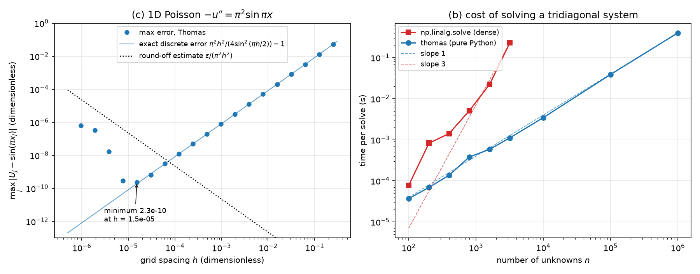
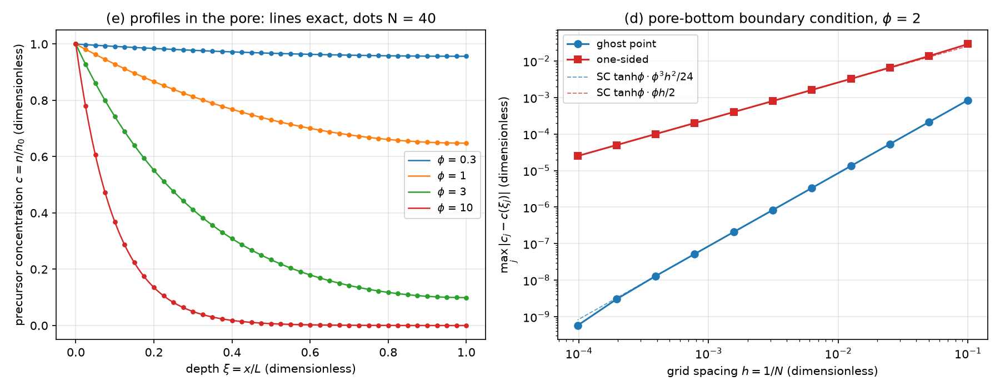
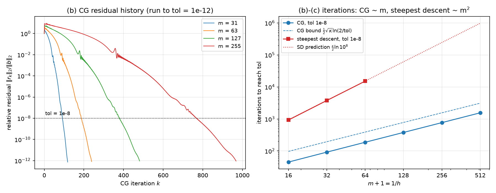
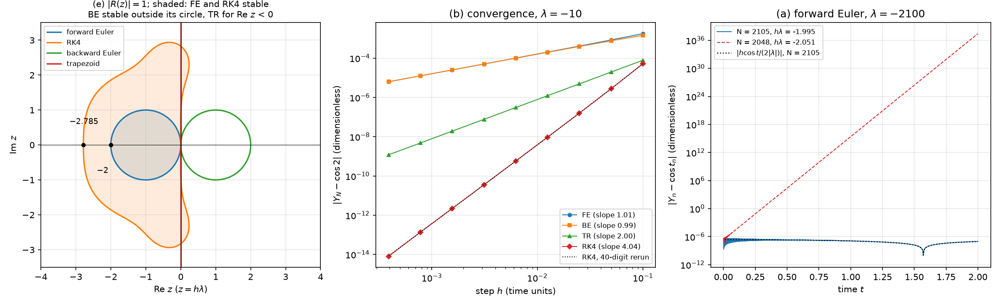
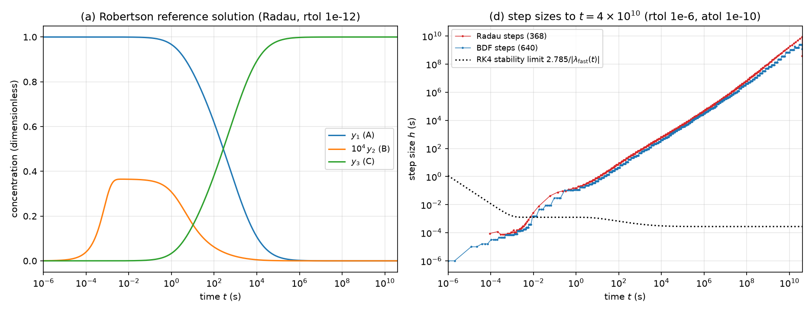

# Week 3: Tridiagonal and conjugate-gradient solvers, explicit vs implicit time stepping, and the stiff Robertson reaction

Two themes: the cost of solving Ax = b depends on the structure of A (dense elimination, the Thomas algorithm, conjugate gradients), and for y′ = f(y) the step of an explicit method is bound by stability, so stiff problems need implicit methods. The applications are step coverage in a deep CVD pore and the Robertson reaction, a classic stiff test problem. Every core algorithm is written from scratch; `np.linalg.solve`, `solve_banded`, `spsolve` and `solve_ivp` are used only for comparison.

The executed notebook [`work/lab03.ipynb`](work/lab03.ipynb) shows every number and figure; [`work/lab03.html`](work/lab03.html) is the same notebook as a web page.

## Tasks

| Task | What is done | Checked against |
|---|---|---|
| 0 | Gaussian elimination without pivoting, eigenvalues, condition numbers; the Hilbert matrix (small residual, large error) | hand elimination; closed forms for the tridiagonal T; the exact integer inverse of H |
| 1 | Thomas algorithm and its cost; 1D Poisson down to the round-off limit; reaction–diffusion in a CVD pore with ghost-point and one-sided boundary conditions; step coverage | LAPACK; the exact discrete error formula; the exact solution of the difference equations |
| 2 | Matrix-free conjugate gradients and steepest descent for 2D Poisson, m = 15 … 511 | `spsolve`; the exact discrete solution by a sine transform (DST); the error equation for error/h² |
| 3 | Forward and backward Euler, trapezoidal rule and RK4 on y′ = λ(y − cos t) − sin t: LeVeque Tables 7.1 and 8.1, orders, stability limits and regions | 40-digit `decimal` reruns of the same recurrences; LeVeque's tables; closed-form amplification factors |
| 4 | The Robertson reaction: reference solution, time scales, fixed-step RK4, library solvers, backward Euler + Newton written from scratch, the tolerance trap | literature values, the Test Set reference at t = 10¹¹, the long-time asymptote, eigenvalues from a quadratic, conservation |

## Key results

- **Small residual, large error.** For the Hilbert matrix the residual stays at 10⁻¹⁶ while the error grows to 24% at n = 12 in this run, always within κε. (This error is pure round-off and depends on the LAPACK build: other machines give 28% or 70%, all within κε = 380%.) The exact condition number at n = 14 is 1.85×10¹⁹; `np.linalg.cond` gives only 2.9×10¹⁷ here.
- **Thomas and 1D Poisson.** Thomas agrees with LAPACK to 2×10⁻¹⁶ and its time grows ∝ n. The Poisson error equals the exact discrete error formula (ratio within 1 ± 5×10⁻⁷ for k ≤ 10, slope 2.001) until round-off takes over; the minimum, 2.3×10⁻¹⁰, is at h = 1.5×10⁻⁵.
- **CVD boundary conditions.** The program matches the exact solution of the difference equations to round-off, so the error of each boundary form has a closed form: ghost-point error × N² → 0.08541 (second order), one-sided error × N → 0.2562 (first order). Step coverage SC ≥ 0.9 at aspect ratio 20 needs a sticking probability s ≤ 1.82×10⁻⁴.
- **Conjugate gradients.** 45, 92, 187, 379, 768 and 1557 iterations for m = 15 … 511, i.e. ∝ m (about 3(m + 1)); steepest descent needs 926, 3772 and 15173, ∝ m². The DST solution separates the iteration error from the discretization error, and error/h² → 0.09304, which matches max|e| of the error equation to 5 digits.
- **Stability and stiffness.** LeVeque's Tables 7.1 and 8.1 are reproduced. The forward-Euler error of 10³⁷ at N = 2048 is amplified truncation error, not round-off: the 40-digit rerun gives the same −2.652597×10³⁷ to 7×10⁻¹⁰. Orders: FE 1.008, BE 0.992, TR 2.000, RK4 4.04. The RK4 real-axis limit is −2.785.
- **Robertson.** Radau and LSODA agree to 1.9×10⁻⁸; at t = 40 the solution matches the literature to 1.6×10⁻¹⁰, and at t = 10¹¹ Radau is within 3.2×10⁻¹⁰ of the Test Set reference. Fixed-step RK4 with h = 10⁻³ becomes unstable at t* = 16.0 and blows up at t = 31.19; Radau reaches t = 4×10¹⁰ in 368 steps. The backward Euler written from scratch takes 171 steps for M = 10 with 3–4 Newton iterations per step. At default tolerances BDF reports success but ends with y₁ = −2.2×10⁶, because atol = 10⁻⁶ is larger than y₂ itself.

## Validation

Each value of this run next to an independent check: a theoretical value, a closed form or exact formula, a 40-digit rerun, the exact discrete solution, another method, or a literature value. Rows marked (mag.) are compared only in order of magnitude; rows marked (bound) are bounds.

| Task | Quantity | This run | Check | Check from | Rel. diff |
|---|---|---|---|---|---|
| 0 | cond T, m = 1000 | 406095.04 | 406095.04 | cot^2(pi/(2(m+1))) | 6.0×10⁻¹² |
| 0 | Hilbert kappa (np.cond), n = 14 | 2.9040042×10¹⁷ | 1.8533817×10¹⁹ | exact inverse | 9.8×10⁻¹ |
| 1a | random: rel. diff vs np.linalg.solve | 1.8645767×10⁻¹⁶ | 0 | LAPACK | 1.9×10⁻¹⁶\* |
| 1c | Poisson max error, k = 10 | 7.8436569×10⁻⁷ | 7.8436606×10⁻⁷ | exact discrete error | 4.7×10⁻⁷ |
| 1d | SC ghost, N = 20 | 0.2660156 | 0.2660156 | 1/cosh(N theta) | 2.1×10⁻¹⁴ |
| 1d | ghost error \* N^2, N = 320 | 0.085413337 | 0.08541356 | SC tanh(phi) phi^3/24 | 2.6×10⁻⁶ |
| 2b | max error tol 1e-12, m = 255 | 1.4196416×10⁻⁶ | 1.4196416×10⁻⁶ | exact discrete sol. (DST) | 1.8×10⁻¹⁰ |
| 2b | error/h^2, m = 511 | 0.093040034 | 0.093040056 | error equation max\|e\| | 2.3×10⁻⁷ |
| 2c | SD iterations, m = 63 | 15173 | 15283.451 | (kappa/2) ln(1e8) | 7.2×10⁻³ |
| 3a | FE error, N = 2048 | −2.652597×10³⁷ | −2.652597×10³⁷ | 40-digit rerun | 6.5×10⁻¹⁰ |
| 3b | RK4 \|error\|, N = 5120 | 8.1046281×10⁻¹⁵ | 8.5705934×10⁻¹⁵ | 40-digit rerun | 5.4×10⁻² |
| 3d | case 2, h = 0.2: \|TR - cos3\| | 0.49985002 | 0.49985 | LeVeque Table 8.1 | 4.4×10⁻⁸ |
| 4a | t=40: max rel. diff vs literature | 1.6120993×10⁻¹⁰ | 0 | literature (10 digits) | 1.6×10⁻¹⁰\* |
| 4a | t=1e11: Radau rel. diff (y1) | −3.1627856×10⁻¹⁰ | 0 | Test Set reference | 3.2×10⁻¹⁰\* |
| 4b | lam\_fast at t = 40 | −3392.7881 | −3392.7881 | np.linalg.eigvals | 4.0×10⁻¹⁶ |
| 4e | M=10: steps | 171 | 171 | 17 M + 1 | 0 |
| 4f | BDF default: final y1 | −2235254.8 | 5.2083452×10⁻⁸ | reference | 4.3×10¹³ |

<details>
<summary>Full summary table (135 rows, as printed at the end of the notebook)</summary>

`05` is the value printed in the course's reference solution (not included in this repository); entries marked (mag.) there are numbers the reference itself calls "order of magnitude". A `*` in `Rel. diff` means the check value is 0 and the absolute value is shown. Timings differ from run to run.

| Task | Quantity | This run | Check | Check from | Rel. diff | 05 |
|---|---|---|---|---|---|---|
| 0 | max \|gauss x - (1,2,3)\| | 0 | 0 | exact | 0\* | 0 |
| 0 | U diagonal: U[1,1] | 2.5 | 2.5 | hand elimination | 0 | 2.5 |
| 0 | U diagonal: U[2,2] | 3.6 | 3.6 | hand elimination | 0 | 3.6 |
| 0 | c[2] | 10.8 | 10.8 | hand elimination | 0 | 10.8 |
| 0 | S eigenvalues max\|Sv - lam v\| | 0 | 0 | exact | 0\* | &lt; 1e-14 |
| 0 | T(m=10) eig: max\|num - formula\| | 4.4408921×10⁻¹⁶ | 0 | closed form | 4.4×10⁻¹⁶\* | 4e-16 |
| 0 | T(m=10) smallest eigenvalue | 0.081014053 | 0.081014053 | 4 sin^2(pi/22) | 4.6×10⁻¹⁵ | 0.081014 |
| 0 | cond T, m = 10 | 48.37415 | 48.37415 | cot^2(pi/(2(m+1))) | 4.4×10⁻¹⁶ | 48.374150 |
| 0 | cond T, m = 100 | 4133.6429 | 4133.6429 | cot^2(pi/(2(m+1))) | 5.6×10⁻¹⁴ | 4133.6429 |
| 0 | cond T, m = 1000 | 406095.04 | 406095.04 | cot^2(pi/(2(m+1))) | 6.0×10⁻¹² | 406095.04 |
| 0 | Hilbert kappa (np.cond), n = 4 | 15513.739 | 15513.739 | exact inverse | 1.9×10⁻¹³ | 1.55e4 |
| 0 | Hilbert kappa (np.cond), n = 8 | 1.5257576×10¹⁰ | 1.5257576×10¹⁰ | exact inverse | 1.3×10⁻⁸ | 1.53e10 |
| 0 | Hilbert kappa (np.cond), n = 10 | 1.6025018×10¹³ | 1.6026287×10¹³ | exact inverse | 7.9×10⁻⁵ | 1.60e13 |
| 0 | Hilbert kappa (np.cond), n = 12 | 1.6512901×10¹⁶ | 1.7132289×10¹⁶ | exact inverse | 3.6×10⁻² | 1.6e16 |
| 0 | Hilbert kappa (np.cond), n = 14 | 2.9040042×10¹⁷ | 1.8533817×10¹⁹ | exact inverse | 9.8×10⁻¹ | 2.5e17 |
| 0 | Hilbert max error, n = 8 | 3.0809197×10⁻⁸ | 3.3878624×10⁻⁶ | bound kappa\*eps | 9.9×10⁻¹ | 1.3e-7 (mag.) |
| 0 | Hilbert max error, n = 10 | 0.00025148265 | 0.0035585505 | bound kappa\*eps | 9.3×10⁻¹ | 2.4e-5 (mag.) |
| 0 | Hilbert max error, n = 12 | 0.23540371 | 3.8041324 | bound kappa\*eps | 9.4×10⁻¹ | 0.28 (mag.) |
| 0 | Hilbert max error, n = 14 | 5.8199277 | 4115.3341 | bound kappa\*eps | 1.0 | 5.5 (mag.) |
| 0 | Hilbert max rel. residual | 1.4167427×10⁻¹⁶ | 0 | exact | 1.4×10⁻¹⁶\* | &lt;= 2e-16 |
| 1a | max \|thomas - (1,2,3)\| | 0 | 0 | exact | 0\* | 0 or 1e-16 |
| 1a | max \|thomas - (1,1,1,1)\| | 2.220446×10⁻¹⁶ | 0 | exact | 2.2×10⁻¹⁶\* | 0 or 1e-16 |
| 1a | random: rel. diff vs np.linalg.solve | 1.8645767×10⁻¹⁶ | 0 | LAPACK | 1.9×10⁻¹⁶\* | 2e-16 |
| 1a | random: rel. diff vs solve\_banded | 1.8645767×10⁻¹⁶ | 0 | LAPACK banded | 1.9×10⁻¹⁶\* | 2e-16 |
| 1b | timing slope, dense solve | 2.4166347 | 3 | theory n^3 (mag.) | 1.9×10⁻¹ | 2.5-3 |
| 1b | timing slope, thomas | 0.99553363 | 1 | theory n (mag.) | 4.5×10⁻³ | ~1 |
| 1b | thomas time, n = 1e6 (s) | 0.39869303 |  |  |  | 1.7 (mag.) |
| 1c | Poisson max error, k = 2 | 0.053029288 | 0.053029288 | exact discrete error | 2.9×10⁻¹⁵ | 5.3029e-02 |
| 1c | Poisson max error, k = 5 | 0.00080357768 | 0.00080357768 | exact discrete error | 3.2×10⁻¹² | 8.0358e-04 |
| 1c | Poisson max error, k = 10 | 7.8436569×10⁻⁷ | 7.8436606×10⁻⁷ | exact discrete error | 4.7×10⁻⁷ | 7.8437e-07 |
| 1c | Poisson slope (k = 3-10) | 2.0011206 | 2.0011205 | fit to exact formula | 2.7×10⁻⁸ | 2.000 |
| 1c | Poisson best h | 1.5258789×10⁻⁵ | 7.2319513×10⁻⁵ | rough crossing (mag.) | 7.9×10⁻¹ | 1.5e-05 |
| 1c | Poisson min error | 2.3217051×10⁻¹⁰ |  |  |  | 2e-10 (mag.) |
| 1d | ghost slope (j = 0-5) | 1.9992836 | 2 | theory order | 3.6×10⁻⁴ | 1.999 |
| 1d | one-sided slope (j = 0-5) | 1.0332879 | 1 | theory order | 3.3×10⁻² | 1.03 |
| 1d | SC ghost, N = 10 | 0.2666538 | 0.2666538 | 1/cosh(N theta) | 1.0×10⁻¹⁵ | 0.2666538 |
| 1d | SC ghost, N = 20 | 0.2660156 | 0.2660156 | 1/cosh(N theta) | 2.1×10⁻¹⁴ | 0.2660156 |
| 1d | ghost error \* N^2, N = 320 | 0.085413337 | 0.08541356 | SC tanh(phi) phi^3/24 | 2.6×10⁻⁶ | 0.0854 |
| 1d | one-sided error \* N, N = 10240 | 0.25627068 | 0.25624068 | SC tanh(phi) phi/2 | 1.2×10⁻⁴ | ~0.26 |
| 1d | max \|program - discrete sol.\| | 2.4094898×10⁻¹⁰ | 0 | exact (round-off) | 2.4×10⁻¹⁰\* |  |
| 1e | SC rel. diff N=200, phi = 0.1 | 1.0770695×10⁻¹⁰ |  |  |  | 1e-10 |
| 1e | SC rel. diff N=200, phi = 0.3 | 8.1914158×10⁻⁹ |  |  |  | 8e-9 |
| 1e | SC rel. diff N=200, phi = 1 | 7.9332592×10⁻⁷ |  |  |  | 8e-7 |
| 1e | SC rel. diff N=200, phi = 3 | 2.7985595×10⁻⁵ |  |  |  | 2.8e-5 |
| 1e | SC rel. diff N=200, phi = 10 | 0.0010419162 |  |  |  | 1.0e-3 |
| 1e | s limit for SC >= 0.9, AR = 10 | 0.0007274158 | 0.00072741613 | numerical SC, N = 200 | 4.5×10⁻⁷ | 7.27e-04 |
| 1e | s limit for SC >= 0.9, AR = 20 | 0.00018185395 | 0.00018185403 | numerical SC, N = 200 | 4.5×10⁻⁷ | 1.82e-04 |
| 1e | s limit for SC >= 0.9, AR = 50 | 2.9096632×10⁻⁵ | 2.9096645×10⁻⁵ | numerical SC, N = 200 | 4.5×10⁻⁷ | 2.91e-05 |
| 1e | SC, AR = 20, s = 1e-3 | 0.60152108 | 0.60152174 | numerical, N = 200 | 1.1×10⁻⁶ | 0.602 |
| 2a | m=7: max \|CG - spsolve\| | 8.3266727×10⁻¹⁷ | 0 | direct solve | 8.3×10⁻¹⁷\* | &lt; 1e-10 |
| 2b | CG iterations tol 1e-8, m = 15 | 45 | 48 | 3(m+1) (approx.) | 6.2×10⁻² | 45 |
| 2b | CG iterations tol 1e-8, m = 31 | 92 | 96 | 3(m+1) (approx.) | 4.2×10⁻² | 92 |
| 2b | CG iterations tol 1e-8, m = 63 | 187 | 192 | 3(m+1) (approx.) | 2.6×10⁻² | 187 |
| 2b | CG iterations tol 1e-8, m = 127 | 379 | 384 | 3(m+1) (approx.) | 1.3×10⁻² | 379 |
| 2b | CG iterations tol 1e-8, m = 255 | 768 | 768 | 3(m+1) (approx.) | 0 | 768 |
| 2b | CG iterations tol 1e-8, m = 511 | 1557 | 1536 | 3(m+1) (approx.) | 1.4×10⁻² | 1557 |
| 2b | max error tol 1e-12, m = 15 | 0.00036236331 | 0.00036236331 | exact discrete sol. (DST) | 2.7×10⁻¹² | 3.6236e-4 |
| 2b | max error tol 1e-12, m = 63 | 2.2713698×10⁻⁵ | 2.2713698×10⁻⁵ | exact discrete sol. (DST) | 3.7×10⁻¹² | 2.2714e-5 |
| 2b | max error tol 1e-12, m = 255 | 1.4196416×10⁻⁶ | 1.4196416×10⁻⁶ | exact discrete sol. (DST) | 1.8×10⁻¹⁰ | 1.4196e-6 |
| 2b | slope iterations vs m+1 | 1.0219103 | 1 | theory sqrt(kappa) ~ m | 2.2×10⁻² | 1.02 |
| 2b | slope max error vs h | 1.9991763 | 2 | theory order | 4.1×10⁻⁴ | 1.999 |
| 2b | error/h^2, m = 511 | 0.093040034 | 0.093040056 | error equation max\|e\| | 2.3×10⁻⁷ | 0.0930 |
| 2c | SD iterations, m = 15 | 926 | 949.46515 | (kappa/2) ln(1e8) | 2.5×10⁻² | 926 |
| 2c | SD iterations, m = 31 | 3772 | 3816.2591 | (kappa/2) ln(1e8) | 1.2×10⁻² | 3772 |
| 2c | SD iterations, m = 63 | 15173 | 15283.451 | (kappa/2) ln(1e8) | 7.2×10⁻³ | 15173 |
| 3a | FE error, N = 2000 | −1.4525165×10⁷⁶ | −1.4525165×10⁷⁶ | 40-digit rerun | 1.9×10⁻¹¹ | -1.45e76 (mag.) |
| 3a | FE error, N = 2048 | −2.652597×10³⁷ | −2.652597×10³⁷ | 40-digit rerun | 6.5×10⁻¹⁰ | -3e37 (mag.) |
| 3a | FE error, N = 2105 | −9.4097392×10⁻⁸ | −9.4097391×10⁻⁸ | 40-digit rerun | 5.5×10⁻⁹ | -9.4097e-08 |
| 3a | FE error, N = 2500 | −7.9229778×10⁻⁸ | −7.9229778×10⁻⁸ | 40-digit rerun | 1.9×10⁻¹⁰ | -7.92298e-08 |
| 3a | FE error, N = 5000 | −3.9603337×10⁻⁸ | −3.9603337×10⁻⁸ | 40-digit rerun | 3.5×10⁻¹⁰ | -3.96033e-08 |
| 3a | FE error vs formula, N = 2105 | −9.4097392×10⁻⁸ | −9.4140219×10⁻⁸ | h cos2/(2\|lam\|) | 4.5×10⁻⁴ |  |
| 3a | FE error vs formula, N = 2500 | −7.9229778×10⁻⁸ | −7.9266064×10⁻⁸ | h cos2/(2\|lam\|) | 4.6×10⁻⁴ |  |
| 3a | FE error vs formula, N = 5000 | −3.9603337×10⁻⁸ | −3.9633032×10⁻⁸ | h cos2/(2\|lam\|) | 7.5×10⁻⁴ |  |
| 3b | FE slope | 1.0080961 | 1 | theory order | 8.1×10⁻³ | 1.008 |
| 3b | BE slope | 0.99170619 | 1 | theory order | 8.3×10⁻³ | 0.992 |
| 3b | TR slope | 2.0000205 | 2 | theory order | 1.0×10⁻⁵ | 2.000 |
| 3b | RK4 slope | 4.0407847 | 4 | theory order | 1.0×10⁻² | 4.04 |
| 3b | RK4 \|error\|, N = 5120 | 8.1046281×10⁻¹⁵ | 8.5705934×10⁻¹⁵ | 40-digit rerun | 5.4×10⁻² | 8e-15 (round-off) |
| 3b | TR \|error\|, N = 1280 | 1.9154813×10⁻⁸ | 1.9154813×10⁻⁸ | 40-digit rerun | 1.8×10⁻⁸ | 1.915e-08 |
| 3c | RK4 real-axis limit | −2.7852936 | −2.7852936 | lecture 4.7 | 1.5×10⁻¹⁰ | -2.785293563 |
| 3c | critical h, FE | 0.00095238095 | 0.00095238095 | 2/\|lam\| | 0 | 9.5238e-04 |
| 3c | critical h, RK4 | 0.0013263303 |  |  |  | 1.32633e-03 |
| 3c | RK4 error, N = 1500 | −4.8812438×10⁹ | −4.8812438×10⁹ | 40-digit rerun | 1.8×10⁻¹¹ | -5e9 (mag.) |
| 3c | RK4 error, N = 1520 | 4.3934135×10⁻⁶ | 4.3934135×10⁻⁶ | 40-digit rerun | 2.9×10⁻¹⁰ | 4.4e-06 |
| 3c | RK4 error, N = 2000 | 6.3731936×10⁻⁸ | 6.3731936×10⁻⁸ | 40-digit rerun | 1.2×10⁻⁹ | 6.37e-08 |
| 3c | BE error, N = 10 (h\|lam\| = 420) | 1.6847819×10⁻⁵ |  |  |  | 1.69e-05 |
| 3c | TR error, N = 10 (h\|lam\| = 420) | 1.4501348×10⁻⁶ |  |  |  | 1.45e-06 |
| 3d | case 1, h = 0.2: \|BE - cos3\| | 9.7730741×10⁻⁸ | 9.7731×10⁻⁸ | LeVeque Table 8.1 | 2.6×10⁻⁶ | 9.7731E-08 |
| 3d | case 1, h = 0.2: \|TR - cos3\| | 4.7228865×10⁻¹⁰ | 4.7229×10⁻¹⁰ | LeVeque Table 8.1 | 2.9×10⁻⁶ | 4.7229E-10 |
| 3d | case 1, h = 0.1: \|BE - cos3\| | 4.9223295×10⁻⁸ | 4.9223×10⁻⁸ | LeVeque Table 8.1 | 6.0×10⁻⁶ | 4.9223E-08 |
| 3d | case 1, h = 0.1: \|TR - cos3\| | 1.1771972×10⁻¹⁰ | 1.1772×10⁻¹⁰ | LeVeque Table 8.1 | 2.4×10⁻⁶ | 1.1772E-10 |
| 3d | case 2, h = 0.2: \|BE - cos3\| | 9.7730741×10⁻⁸ | 9.7731×10⁻⁸ | LeVeque Table 8.1 | 2.6×10⁻⁶ | 9.7731E-08 |
| 3d | case 2, h = 0.2: \|TR - cos3\| | 0.49985002 | 0.49985 | LeVeque Table 8.1 | 4.4×10⁻⁸ | 4.9985E-01 |
| 3d | case 2, h = 0.1: \|BE - cos3\| | 4.9223295×10⁻⁸ | 4.9223×10⁻⁸ | LeVeque Table 8.1 | 6.0×10⁻⁶ | 4.9223E-08 |
| 3d | case 2, h = 0.1: \|TR - cos3\| | 0.49940036 | 0.4994 | LeVeque Table 8.1 | 7.2×10⁻⁷ | 4.9940E-01 |
| 3d | h = 0.4 row: BE - cos3 (both cases) | 0.047770333 | 0.047770156 | cos 2.8 - cos 3 | 3.7×10⁻⁶ | 4.7770e-02 |
| 3d | case 2, h = 0.4: TR - cos3 | −0.45219484 |  |  |  | -0.45219 |
| 4a | Radau vs LSODA, max rel. diff | 1.9318672×10⁻⁸ | 0 | two methods | 1.9×10⁻⁸\* | 1.9e-08 |
| 4a | t=40: max rel. diff vs literature | 1.6120993×10⁻¹⁰ | 0 | literature (10 digits) | 1.6×10⁻¹⁰\* | 0 |
| 4a | t=1e11: Radau rel. diff (y1) | −3.1627856×10⁻¹⁰ | 0 | Test Set reference | 3.2×10⁻¹⁰\* | -3.8e-10 |
| 4a | t=1e11: LSODA rel. diff (y1) | 4.1080192×10⁻⁸ | 0 | Test Set reference | 4.1×10⁻⁸\* | 4e-08 |
| 4a | y1 t at t = 4e10 | 2083.3381 | 2083.3333 | asymptote 2083.33 | 2.3×10⁻⁶ | 2083.34 |
| 4a | y2 t at t = 4e10 | 0.0083333527 | 0.0083333333 | asymptote 1/120 | 2.3×10⁻⁶ | 0.0083334 |
| 4a | max \|y1+y2+y3-1\| (Radau ref.) | 3.1086245×10⁻¹⁵ | 0 | conservation | 3.1×10⁻¹⁵\* | 2e-15 |
| 4b | lam\_fast at t = 40 | −3392.7881 | −3392.7881 | np.linalg.eigvals | 4.0×10⁻¹⁶ | -3392.8 |
| 4b | lam\_slow at t = 40 | −0.021418877 | −0.021418877 | np.linalg.eigvals | 6.0×10⁻¹⁴ | -0.02142 |
| 4b | lam\_fast at t = 4e10 | −10000.039 | −10000 | -k3 (y3 -> 1) | 3.9×10⁻⁶ | -10000.0 |
| 4b | lam\_slow at t = 4e10 | −4.9999921×10⁻¹¹ | −4.9997968×10⁻¹¹ | np.linalg.eigvals | 3.9×10⁻⁵ | -5.000e-11 |
| 4b | max \|third eigenvalue\| | 1.9340356×10⁻¹⁶ | 0 | exactly 0 | 1.9×10⁻¹⁶\* | &lt; 1e-14 |
| 4b | y2 maximum | 3.6487237×10⁻⁵ |  |  |  | 3.64872e-05 |
| 4b | t of y2 maximum | 0.0045573949 |  |  |  | 4.56e-03 |
| 4c | N=40000: blow-up time | 31.186 |  |  |  | 31.14 (mag.) |
| 4c | N=40000: y1+y2+y3-1 when y2 &lt; 0 | 5.7731597×10⁻¹⁵ | 0 | conservation | 5.8×10⁻¹⁵\* | 3e-15 |
| 4c | N=40000: t\* | 15.989415 |  |  |  | 16.0 |
| 4c | N=44000: rel. error at t = 40 | 0.25671863 |  |  |  | 0.26 (mag.) |
| 4c | N=50000: rel. error at t = 40 | 1.4742629×10⁻¹⁰ | 0 | reference | 1.5×10⁻¹⁰\* | 1.5e-10 |
| 4c | N=60000: rel. error at t = 40 | 1.1686208×10⁻¹¹ | 0 | reference | 1.2×10⁻¹¹\* | 1.2e-11 |
| 4d | RK45 steps to 4e+01 | 34537 |  |  |  | 34537 (mag.) |
| 4d | Radau steps to 4e+01 | 78 |  |  |  | 78 (mag.) |
| 4d | Radau steps to 4e+10 | 368 |  |  |  | 368 (mag.) |
| 4d | BDF steps to 4e+10 | 640 |  |  |  | 640 (mag.) |
| 4d | LSODA steps to 4e+10 | 848 |  |  |  | 848 (mag.) |
| 4d | BDF to 4e10: end rel. error | 0.0010735975 |  |  |  | 1.1e-03 |
| 4d | Radau to 4e10: max step | 8.5307304×10⁹ |  |  |  | 8.5e+09 |
| 4d | max \|sum - 1\| over all runs | 7.5495166×10⁻¹⁵ | 0 | conservation | 7.5×10⁻¹⁵\* | &lt; 1e-13 |
| 4e | M=10: steps | 171 | 171 | 17 M + 1 | 0 | 171 |
| 4e | M=10: rel. error at t = 40 | 0.037060906 |  |  |  | 3.71e-02 |
| 4e | M=10: rel. error at t = 4e10 | 0.25891295 |  |  |  | 0.259 |
| 4e | slope error vs 1/M, t = 40 | 0.99154648 | 1 | theory order | 8.5×10⁻³ | 0.99 |
| 4e | slope error vs 1/M, t = 4e10 | 1.03807 | 1 | theory order | 3.8×10⁻² | 1.04 |
| 4f | BDF default: final y1 | −2235254.8 | 5.2083452×10⁻⁸ | reference | 4.3×10¹³ | -2.235e+06 |
| 4f | BDF default: first t with y2 &lt; 0 | 1.8889814×10¹⁰ |  |  |  | 1.9e10 |
| 4f | BDF default: max \|sum - 1\| | 5.8207661×10⁻¹¹ | 4.8849813×10⁻¹⁰ | eps \* 2.2e6 | 8.8×10⁻¹ | 2.3 |
| 4f | Radau default: rel. error y1 | 0.03256362 | 0.001 | rtol | 3.2×10¹ | (no number) |
| 4f | LSODA default: final y1 | −3.1763381×10⁻⁷ | 5.2083452×10⁻⁸ | reference | 7.1 | -3.19e-07 |

</details>

## Differences from the course's reference solution

Most values of the course's reference solution agree with this run to the digits they give. The last section of the notebook lists, with numbers, the few places where they differ. In short:

- The 10³⁷ of forward Euler at N = 2048 depends on the step size rather than on round-off: the 40-digit rerun agrees with double to 7×10⁻¹⁰, while h = 0.000976 gives 2.8×10³⁶ and h = 0.000977 gives 1.5×10³⁸.
- The 8×10⁻¹⁵ of RK4 at N = 5120 is still truncation error: the 40-digit rerun gives 8.6×10⁻¹⁵, on the slope-4 line.
- From the exact inverse, the condition number of the 14 × 14 Hilbert matrix is 1.85×10¹⁹ (κε = 4.1×10³); `np.linalg.cond` underestimates it for n ≥ 12, as the reference also notes.
- BDF's max|y₁ + y₂ + y₃ − 1| = 2.3 at default tolerances is far above the round-off of the sum (about 5×10⁻¹⁰), so the total really drifts; without the analytic Jacobian it reaches 40.6 here.
- Radau at default tolerances also misses: its y₁ is 3.3% off, 33 times rtol.

## Figures



*Task 1. (c) Thomas solution of 1D Poisson: the maximum error follows the exact discrete error until round-off takes over, with the minimum 2.3×10⁻¹⁰ at h = 1.5×10⁻⁵. (b) Time per solve: Thomas grows ∝ n, dense elimination much faster (timings vary from run to run).*



*Task 1. (e) Precursor concentration in the pore for φ = 0.3, 1, 3 and 10: exact solution (lines) and N = 40 (dots). (d) Error of the pore-bottom boundary condition against h for φ = 2: the ghost point is second order and the one-sided difference first order, each on its closed-form error line.*



*Task 2. (b) CG residual histories for m = 31 to 255, run to tol = 10⁻¹². (b)–(c) Iterations to reach tol = 10⁻⁸: CG grows ∝ m and stays below its bound ½√κ ln(2/tol); steepest descent grows ∝ m² and follows (κ/2) ln 10⁸.*



*Task 3. (e) Stability regions |R(z)| = 1 of forward Euler, RK4, backward Euler and the trapezoidal rule. (b) Convergence for λ = −10, with slopes 1.01, 0.99, 2.00 and 4.04; the RK4 points lie on the 40-digit rerun. (a) Forward Euler for λ = −2100: at hλ = −1.995 (N = 2105) the error stays on the steady state h cos t / (2|λ|); at hλ = −2.051 (N = 2048) it grows to 10³⁷.*



*Task 4. (a) Robertson reference solution (Radau, rtol 10⁻¹²), with y₂ scaled by 10⁴. (d) Step sizes of Radau (368 steps) and BDF (640 steps) up to t = 4×10¹⁰, against the RK4 stability limit 2.785/|λ_fast(t)|.*

## Files

| File | Contents |
|---|---|
| `work/linear_algebra.py` | `gauss_solve` (no pivoting), tridiagonal matrices, eigenvalues and condition number of T, `hilbert_condition` from the exact inverse |
| `work/tridiagonal.py` | `thomas`, `poisson_1d`, the exact discrete Poisson error |
| `work/cvd.py` | `cvd_solve` (ghost point / one-sided), exact and exact-discrete solutions, step coverage, Thiele modulus |
| `work/cg.py` | matrix-free `lap`, `cg`, `sd`, `poisson_dst`, the manufactured solution and the error equation |
| `work/ode.py` | forward / backward Euler, trapezoidal rule, RK4, stability functions, 40-digit `dcos` and `dsin` |
| `work/robertson.py` | rates, analytic Jacobian, fast and slow eigenvalues, `solve` (wraps `solve_ivp`), fixed-step RK4, backward Euler + Newton |
| `work/test_*.py` | 70 tests (69 when the notebook was run; a test for the Newton warning was added later) |
| `work/lab03.ipynb`, `work/lab03.html` | the executed notebook |
| `work/figures/` | the five figures above |

## Run

```bash
conda activate cms
cd week03/work
pytest -q
jupyter lab lab03.ipynb   # Run All, about 2 minutes
```
