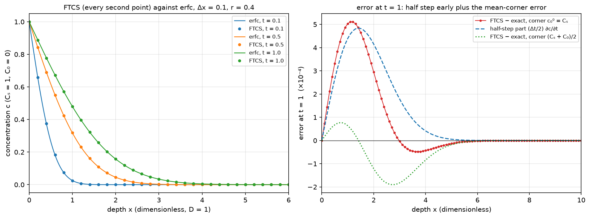
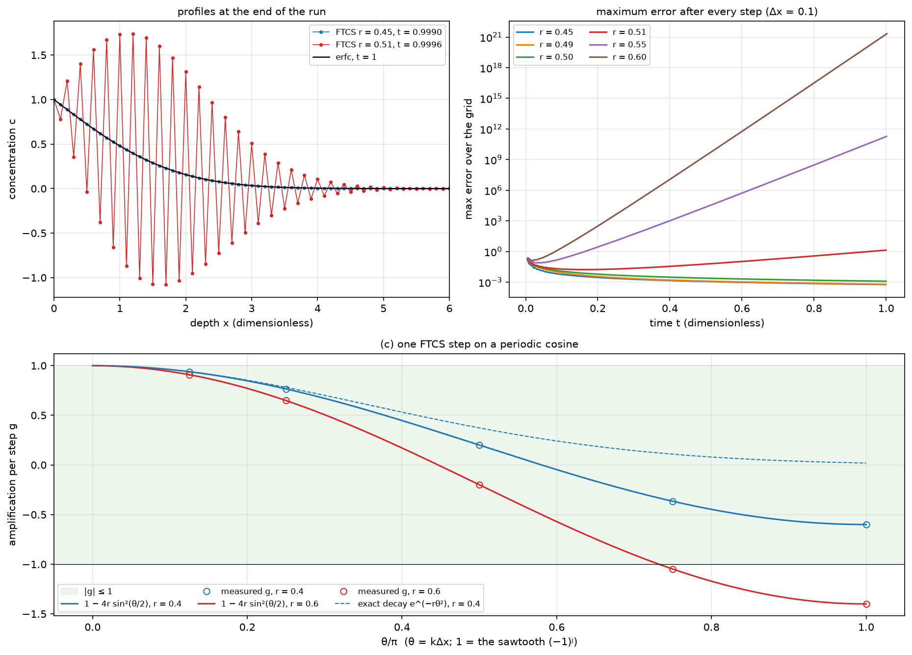
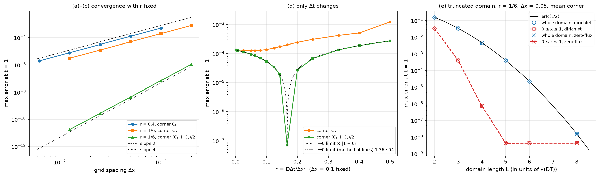
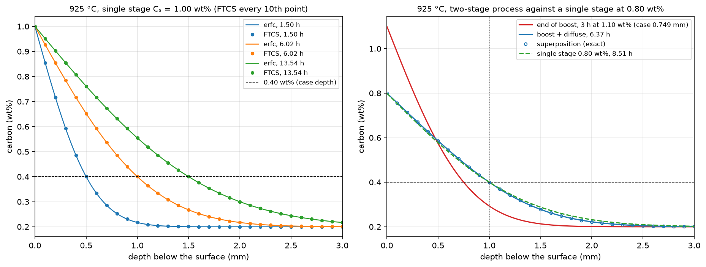

# Week 4: Explicit diffusion (FTCS), its stability limit, and the carburizing of steel

The first partial differential equation of the course: Fick's second law c_t = D c_xx, solved with FTCS (forward Euler in time, the second difference of week 2 in space). Each new value is r, 1 − 2r, r times three old ones, r = DΔt/Δx², so the scheme is a weighted average, and stable, exactly when r ≤ ½. The erfc solution for a semi-infinite solid is the yardstick for every check; the application is gas carburizing of steel in real units, including a boost–diffuse process that a single erfc cannot describe. The FTCS loop is written from scratch with NumPy slices; no PDE solver is called.

The executed notebook [`work/lab04.ipynb`](work/lab04.ipynb) shows every number and figure; [`work/lab04.html`](work/lab04.html) is the same notebook as a web page.

## Tasks

| Task | What is done | Checked against |
|---|---|---|
| 0 | erf, erfc and erfcinv; the erfc solution in the diffusion equation; three FTCS steps by hand | the Simpson rule of week 1; `brentq` roots; the residual against its predicted truncation error from the exact derivatives; the hand table of the lecture notes |
| 1 | FTCS for the semi-infinite solid (Δx = 0.1, r = 0.4): error, absorbed amount, iso-concentration depth, scale invariance | erfc; 2√(t/π); the error split into "half a step early" plus the mean-corner error; three rescaled runs, identical to the last bit |
| 2 | r = 0.45 … 0.60, the measured growth factor, von Neumann on a periodic grid, the stability limit with fixed ends, r = ½ | 1 − 4r sin²(θ/2); the eigenvalues of the method-of-lines matrix; the r = ¼ run on a grid twice as coarse |
| 3 | Orders of convergence for r = 0.4 and r = 1/6 with two corner values; error against r for fixed Δx; truncation of the domain | slopes 2 and 4; the half-step prediction (Δt/2)·0.2420; the r → 0 limit from the semi-discrete system solved exactly; erfc(L/2) |
| 4 | Wells–Mehl diffusivity and case-depth times; FTCS at 925 °C for a single stage and for boost 3 h at 1.10 wt% then diffuse at 0.80 wt%; cost; model uncertainty | erfc; the exact superposition solution and its `brentq` time; a second literature value of D |

## Key results

- **FTCS in one line of NumPy.** At Δx = 0.1 and r = 0.4 the maximum error at t = 1 is 5.112×10⁻⁴, at x = 1.1, and c stays in [0, 1]. Three rescaled runs, (Δx, T, L) = (0.1, 1, 10), (0.2, 4, 20) and (0.05, 0.25, 5), give the identical 5.112257×10⁻⁴.
- **Half a step early.** With the corner c₀⁰ = Cₛ the numerical solution is the exact solution at t + Δt/2: the error equals (Δt/2)c_t plus the error of the mean-corner run to 6.2×10⁻⁷, which explains why it is positive near the surface and falls like 1/t. At r = 1/6 this shift alone keeps FTCS second order (slope 2.000, error 2.0159×10⁻⁴ against the predicted 2.0164×10⁻⁴); with the mean corner (Cₛ + C₀)/2 the slope is 4.000, down to 1.71×10⁻¹¹.
- **The stability cliff.** r = 0.51 first exceeds an error of 1 at step 187, r = 0.60 at step 14 and ends at 2×10²¹. One step multiplies a periodic cosine by exactly 1 − 4r sin²(θ/2) (to 1×10⁻¹⁵); the growth factor measured over 40 steps is 0.5–0.7% low, and converges to |1 − 4r sin²((M − 1)π/(2M))| in longer runs (1.03950 at step 6000 for r = 0.51). With fixed ends the limit is 1/(2 sin²((M − 1)π/(2M))), 0.5125 for M = 10, so r = 0.51 is stable there. At r = ½ every other grid point is wasted: the run equals the r = ¼ run on a grid twice as coarse, to 1×10⁻¹⁶.
- **Only Δt changes.** As r → 0 FTCS becomes the method of lines; solved exactly in time, its error, 1.357×10⁻⁴, is the floor both corners approach. With the mean corner the error is that floor times |1 − 6r| to within 0.3% for every r: the time and space errors cancel at r = 1/6 (valley 7.0×10⁻⁸).
- **Carburizing.** D(925 °C) = 1.745×10⁻¹¹ m²/s, and a 1.0 mm case (0.40 wt% C) takes 6.02 h at Cₛ = 1.00 wt%. FTCS with Δx = 10 μm reproduces it to 1.1×10⁻⁵ wt%, the case depth to 0.03 μm. Boost–diffuse reaches 1.0 mm in 6.373 h with a 0.80 wt% surface, within one step (0.8 s) of the superposition solution and 25% faster than a single stage at 0.80 wt% (8.51 h). The model, not the numerics, limits the answer: another literature value of D changes the time to 7.00 h, and the carbon dependence of D spans 5.55–8.80 h.

## Validation

Each value of this run next to an independent check: a theoretical value, a closed form or exact formula, the predicted truncation error, another run, the method-of-lines limit, the superposition solution, or a literature value. Rows marked (mag.) are compared only in order of magnitude.

| Task | Quantity | This run | Check | Check from | Rel. diff |
|---|---|---|---|---|---|
| 0 | max \|Simpson - erf\|, six z | 7.3607787×10⁻¹⁴ | 0 | exact | 7.4×10⁻¹⁴\* |
| 0 | c\_t - c\_xx at (0.5, 0.2) | 6.8078043×10⁻⁷ | 6.8070644×10⁻⁷ | h^2 truncation terms | 1.1×10⁻⁴ |
| 1 | max error, t = 1 | 0.00051122574 | 0.00048394145 | half step (dt/2) c\_t | 5.6×10⁻² |
| 1 | absorbed amount, t = 1 | 1.1296479 | 1.1283792 | 2 sqrt(t/pi) | 1.1×10⁻³ |
| 1 | scale (0.2, 4, 20): max error | 0.00051122574 | 0.00051122574 | run (0.1, 1, 10) | 0 |
| 1 | max \|e\_Cs - (dt/2)c\_t - e\_mean\| | 6.1711336×10⁻⁷ | 0 | exact if half-step only | 6.2×10⁻⁷\* |
| 2a | r = 0.51: first step with error > 1 | 187 |  |  |  |
| 2b | growth/step, r = 0.51, N = 6000 | 1.0394967 | 1.0394967 | \|1-4r sin^2((M-1)pi/2M)\| | 9.9×10⁻¹³ |
| 2c | max \|g - formula\|, 10 cases | 1.110223×10⁻¹⁵ | 0 | exact | 1.1×10⁻¹⁵\* |
| 2d | r limit, M = 10 | 0.51254282 | 0.51254282 | eigenvalues of A | 0 |
| 3a | slope, dx = 0.0125 -> 0.00625 | 1.9999533 | 2 | theory O(dx^2) | 2.3×10⁻⁵ |
| 3b | max error r=1/6 Cs, dx = 0.1 | 0.00020158678 | 0.00020164227 | half step (dt/2)\*0.2420 | 2.8×10⁻⁴ |
| 3c | slope r=1/6 mean, dx 0.025 -> 0.0125 | 3.9997319 | 4 | theory O(dx^4) | 6.7×10⁻⁵ |
| 3d | mean corner, r = 0.025 | 0.00011533634 | 0.00011531734 | r->0 limit x \|1 - 6r\| | 1.6×10⁻⁴ |
| 4c | case depth, corner mean (mm) | 0.99999752 | 1 | erfc design depth | 2.5×10⁻⁶ |
| 4d | total time (h) | 6.3731692 | 6.3729589 | superposition + brentq | 3.3×10⁻⁵ |
| 4d | max error vs superposition (wt%) | 3.0921313×10⁻⁶ |  |  |  |

<details>
<summary>Full summary table (103 rows, as printed at the end of the notebook)</summary>

`05` is the value printed in the course's reference solution (not included in this repository); entries marked (mag.) there are numbers the reference itself calls "order of magnitude". A `*` in `Rel. diff` means the check value is 0 and the absolute value is shown. Timings differ from run to run.

| Task | Quantity | This run | Check | Check from | Rel. diff | 05 |
|---|---|---|---|---|---|---|
| 0 | erf(1) | 0.84270079 | 0.84270079 | Simpson N=1000 (week 1) | 1.1×10⁻¹⁴ | 0.842701 |
| 0 | erfc(2) | 0.004677735 | 0.004677735 | 1 - Simpson N=1000 | 1.6×10⁻¹¹ | 4.6777e-3 |
| 0 | max \|Simpson - erf\|, six z | 7.3607787×10⁻¹⁴ | 0 | exact | 7.4×10⁻¹⁴\* | 7e-14 |
| 0 | erfcinv(0.5) | 0.47693628 | 0.47693628 | brentq on erfc | 2.3×10⁻¹⁶ | 0.476936 |
| 0 | erfcinv(0.25) | 0.81341985 | 0.81341985 | brentq on erfc | 2.7×10⁻¹⁶ | 0.813420 |
| 0 | erfcinv(0.01) | 1.8213864 | 1.8213864 | brentq on erfc | 1.2×10⁻¹⁶ | 1.821386 |
| 0 | c\_t (central) at (0.5, 0.2) | 1.1537271 | 1.153727 | analytic c\_t | 9.5×10⁻⁸ | 1.1537271 |
| 0 | c\_t - c\_xx at (0.5, 0.2) | 6.8078043×10⁻⁷ | 6.8070644×10⁻⁷ | h^2 truncation terms | 1.1×10⁻⁴ | 6.8e-7 |
| 0 | c\_t (central) at (1, 1) | 0.21969565 | 0.21969564 | analytic c\_t | 4.3×10⁻⁹ | 0.21969565 |
| 0 | c\_t - c\_xx at (1, 1) | 2.3865909×10⁻⁸ | 2.3823246×10⁻⁸ | h^2 truncation terms | 1.8×10⁻³ | 2.4e-8 |
| 0 | c\_t (central) at (2, 3) | 0.077799777 | 0.077799777 | analytic c\_t | 4.2×10⁻¹⁰ | 0.077799777 |
| 0 | c\_t - c\_xx at (2, 3) | 2.5662805×10⁻⁹ | 2.5529052×10⁻⁹ | h^2 truncation terms | 5.2×10⁻³ | 2.6e-9 |
| 0 | hand r=0.25: c1 after 3 steps | 0.453125 | 0.453125 | lecture notes §5.4 | 0 | 0.453125 |
| 0 | hand r=0.25: c3 after 3 steps | 0.015625 | 0.015625 | lecture notes §5.4 | 0 | 0.015625 |
| 0 | hand r=1: c1 after 3 steps | 2 | 2 | lecture notes §5.4 | 0 | 2 |
| 0 | hand r=1: c2 after 3 steps | −1 | −1 | lecture notes §5.4 | 0 | -1 |
| 0 | int\_0^inf erfc(x/2) dx | 1.1283792 | 1.1283792 | 2/sqrt(pi) | 2.0×10⁻¹⁶ | 1.1283792 |
| 1 | x of the max error | 1.1 |  |  |  | 1.1 |
| 1 | c(1, 1) | 0.48000329 | 0.47950012 | erfc | 1.0×10⁻³ | 0.480003 |
| 1 | min c | 0 | 0 | max. principle: C0 | 0\* | 0 |
| 1 | max c | 1 | 1 | max. principle: Cs | 0 | 1 |
| 1 | most negative error (x = 3.7) | −4.8234999×10⁻⁵ |  |  |  | -4.8e-5 |
| 1 | max error, t = 0.1 | 0.0050560766 | 0.0048394145 | half step (dt/2) c\_t | 4.5×10⁻² | 5.06e-3 |
| 1 | max error, t = 0.5 | 0.0010235817 | 0.0009678829 | half step (dt/2) c\_t | 5.8×10⁻² | 1.02e-3 |
| 1 | absorbed amount, t = 1 | 1.1296479 | 1.1283792 | 2 sqrt(t/pi) | 1.1×10⁻³ | 1.129648 |
| 1 | absorbed amount, t = 1, half step | 1.1296479 | 1.129507 | 2 sqrt((t + dt/2)/pi) | 1.2×10⁻⁴ | 1.4e-4 diff. |
| 1 | max error, t = 1 | 0.00051122574 | 0.00048394145 | half step (dt/2) c\_t | 5.6×10⁻² | 5.11e-4 |
| 1 | depth of c = 0.5, t = 1 | 0.95556412 | 0.95387255 | 2 erfcinv(0.5) sqrt(t) | 1.8×10⁻³ | 0.9556 |
| 1 | scale (0.2, 4, 20): max error | 0.00051122574 | 0.00051122574 | run (0.1, 1, 10) | 0 | 5.112257e-4 |
| 1 | scale (0.05, 0.25, 5): max error | 0.00051122574 | 0.00051122574 | run (0.1, 1, 10) | 0 | 5.112257e-4 |
| 1 | max \|e\_Cs - (dt/2)c\_t - e\_mean\| | 6.1711336×10⁻⁷ | 0 | exact if half-step only | 6.2×10⁻⁷\* |  |
| 2a | max error at end, r = 0.45 | 0.00058044023 |  |  |  | 5.80e-4 |
| 2a | max error at end, r = 0.49 | 0.00063486583 |  |  |  | 6.35e-4 |
| 2a | max error at end, r = 0.50 | 0.0012343809 |  |  |  | 1.23e-3 |
| 2a | max error at end, r = 0.51 (mag.) | 1.3705635 |  |  |  | 1.4 (mag.) |
| 2a | max error at end, r = 0.55 (mag.) | 1.8651963×10¹¹ |  |  |  | 2e11 (mag.) |
| 2a | max error at end, r = 0.60 (mag.) | 2.1362714×10²¹ |  |  |  | 2e21 (mag.) |
| 2a | r = 0.51: first step with error > 1 | 187 |  |  |  | 187 |
| 2a | r = 0.60: first step with error > 1 | 14 |  |  |  | 14 |
| 2b | growth/step, r = 0.51, last 40 | 1.0340754 | 1.0394967 | \|1-4r sin^2((M-1)pi/2M)\| | 5.2×10⁻³ | 1.034 |
| 2b | growth/step, r = 0.55, last 40 | 1.1926384 | 1.1994572 | \|1-4r sin^2((M-1)pi/2M)\| | 5.7×10⁻³ | 1.193 |
| 2b | growth/step, r = 0.60, last 40 | 1.3905399 | 1.3994079 | \|1-4r sin^2((M-1)pi/2M)\| | 6.3×10⁻³ | 1.391 |
| 2b | growth/step, r = 0.51, N = 6000 | 1.0394967 | 1.0394967 | \|1-4r sin^2((M-1)pi/2M)\| | 9.9×10⁻¹³ |  |
| 2b | growth/step, r = 0.55, N = 2000 | 1.199361 | 1.1994572 | \|1-4r sin^2((M-1)pi/2M)\| | 8.0×10⁻⁵ |  |
| 2b | growth/step, r = 0.60, N = 1500 | 1.3990558 | 1.3994079 | \|1-4r sin^2((M-1)pi/2M)\| | 2.5×10⁻⁴ |  |
| 2c | g(pi), r = 0.4 | −0.6 | −0.6 | 1 - 4r sin^2(theta/2) | 0 | -0.600000 |
| 2c | g(pi), r = 0.6 | −1.4 | −1.4 | 1 - 4r sin^2(theta/2) | 0 | -1.400000 |
| 2c | g(3pi/4), r = 0.6 | −1.0485281 | −1.0485281 | 1 - 4r sin^2(theta/2) | 8.5×10⁻¹⁶ | -1.048528 |
| 2c | max \|g - formula\|, 10 cases | 1.110223×10⁻¹⁵ | 0 | exact | 1.1×10⁻¹⁵\* | &lt; 1e-12 |
| 2d | M=10, r=0.51: max\|c - (1-x)\| | 3.1086245×10⁻¹⁵ | 0 | steady state | 3.1×10⁻¹⁵\* | 3e-15 |
| 2d | M=10, r=0.515: max\|c - (1-x)\| (mag.) | 4.2906738×10¹⁰ |  |  |  | 4e10 (mag.) |
| 2d | M=100, r=0.51: max\|c - (1-x)\| (mag.) | 4.6346136×10⁴⁶ |  |  |  | 5e46 (mag.) |
| 2d | r limit, M = 10 | 0.51254282 | 0.51254282 | eigenvalues of A | 0 | 0.5125 |
| 2d | r limit, M = 1000 | 0.50000123 | 0.50000123 | eigenvalues of A | 2.2×10⁻¹⁶ | 0.500001 |
| 2e | max error, r = 1/2, dx = 0.1 | 0.0012343809 | 0.0012343809 | r = 1/4, dx = 0.2 | 4.5×10⁻¹⁴ | 1.2343809e-3 |
| 2e | max \|even points - coarse grid\| | 1.110223×10⁻¹⁶ | 0 | exact (lecture §5.6) | 1.1×10⁻¹⁶\* | 1e-16 |
| 2e | max error on odd points, r = 1/2 | 0.00027206338 |  |  |  | 2.72e-4 |
| 3a | slope, dx = 0.1 -> 0.05 | 1.9973276 | 2 | theory O(dx^2) | 1.3×10⁻³ | 1.997 |
| 3a | slope, dx = 0.0125 -> 0.00625 | 1.9999533 | 2 | theory O(dx^2) | 2.3×10⁻⁵ | 2.000 |
| 3a | max error, dx = 0.00625 | 2.0009144×10⁻⁶ |  |  |  | 2.0009e-6 |
| 3b | slope r=1/6 Cs, dx 0.025 -> 0.0125 | 1.9999077 | 2 | half-step theory | 4.6×10⁻⁵ | 2.000 |
| 3b | max error r=1/6 Cs, dx = 0.1 | 0.00020158678 | 0.00020164227 | half step (dt/2)\*0.2420 | 2.8×10⁻⁴ | 2.0159e-4 |
| 3c | slope r=1/6 mean, dx 0.025 -> 0.0125 | 3.9997319 | 4 | theory O(dx^4) | 6.7×10⁻⁵ | 4.000 |
| 3c | max error r=1/6 mean, dx = 0.0125 | 1.7140178×10⁻¹¹ |  |  |  | 1.7140e-11 |
| 3c | r = 0.1667: Cs vs exact at T + dt/2 | 6.104765×10⁻⁸ | 7.0186568×10⁻⁸ | mean-corner run | 1.3×10⁻¹ | 6e-8 |
| 3c | r = 0.25: Cs vs exact at T + dt/2 | 6.7788979×10⁻⁵ | 6.7847693×10⁻⁵ | mean-corner run | 8.7×10⁻⁴ | 6.78e-5 |
| 3c | r = 0.4: Cs vs exact at T + dt/2 | 0.0001898502 | 0.00019017392 | mean-corner run | 1.7×10⁻³ | 1.899e-4 |
| 3d | mean corner, r = 1/6 (valley) | 7.0186568×10⁻⁸ |  |  |  | 7.019e-8 |
| 3d | mean corner, r = 0.4 | 0.00019017392 | 0.00018993445 | r->0 limit x \|1 - 6r\| | 1.3×10⁻³ | 1.902e-4 |
| 3d | mean corner, r = 0.025 | 0.00011533634 | 0.00011531734 | r->0 limit x \|1 - 6r\| | 1.6×10⁻⁴ | 1.153e-4 |
| 3d | corner Cs, r = 0.025 | 0.0001310255 |  |  |  | 1.310e-4 |
| 3d | r -> 0 limit (method of lines) | 0.00013566746 | 0.00013535751 | FTCS N = 64000, corner Cs | 2.3×10⁻³ | ~1.3e-4 (Cs) |
| 3e | L = 4: max error (at x = L) | 0.004677735 | 0.004677735 | erfc(L/2) | 0 | 4.678e-3 |
| 3e | L = 8: max error (at x = L) | 1.5417258×10⁻⁸ | 1.5417258×10⁻⁸ | erfc(L/2) | 0 | 1.542e-8 |
| 3e | L = 5: max error on 0 &lt;= x &lt;= 1 | 4.4763522×10⁻⁹ | 4.3862722×10⁻⁹ | L = 8 (no truncation) | 2.1×10⁻² | 4.48e-9 |
| 3e | L = 4, zero flux: max error 0&lt;=x&lt;=1 | 7.3875906×10⁻⁷ |  |  |  | 7.39e-7 |
| 4a | D(875 C) (m^2/s) | 9.7160843×10⁻¹² |  |  |  | 9.716e-12 |
| 4a | D(925 C) (m^2/s) | 1.7446311×10⁻¹¹ |  |  |  | 1.745e-11 |
| 4a | D(975 C) (m^2/s) | 2.9891575×10⁻¹¹ |  |  |  | 2.989e-11 |
| 4b | t(0.5 mm), 925 C (h) | 1.503988 |  |  |  | 1.50 |
| 4b | t(1.0 mm), 925 C (h) | 6.0159522 |  |  |  | 6.02 |
| 4b | t(1.5 mm), 925 C (h) | 13.535892 |  |  |  | 13.54 |
| 4b | t(1.0 mm), 875 C (h) | 10.802312 |  |  |  | 10.80 |
| 4b | t(1.0 mm), 975 C (h) | 3.5112292 |  |  |  | 3.51 |
| 4c | max error, corner cs (wt%) | 1.084403×10⁻⁵ |  |  |  | 1.08e-5 |
| 4c | case depth, corner cs (mm) | 1.0000241 | 1 | erfc design depth | 2.4×10⁻⁵ | 1.00002 |
| 4c | max error, corner mean (wt%) | 4.0235027×10⁻⁶ |  |  |  | 4.0e-6 |
| 4c | case depth, corner mean (mm) | 0.99999752 | 1 | erfc design depth | 2.5×10⁻⁶ | 1.00000 |
| 4c | N | 9447 |  |  |  | 9447 |
| 4c | dt (s) | 2.2925191 |  |  |  | 2.2925 |
| 4d | total time (h) | 6.3731692 | 6.3729589 | superposition + brentq | 3.3×10⁻⁵ | 6.373 |
| 4d | diffusion stage (h) | 3.3731692 | 3.3729589 | superposition + brentq | 6.2×10⁻⁵ | 3.373 |
| 4d | max error vs superposition (wt%) | 3.0921313×10⁻⁶ |  |  |  | 3.1e-6 |
| 4d | case depth at end of boost (mm) | 0.74931904 | 0.7493184 | erfc at C\_b | 8.5×10⁻⁷ | 0.749 |
| 4d | single stage 0.80: t(1 mm) (h) | 8.506137 |  |  |  | 8.51 |
| 4d | single stage 1.10: t(1 mm) (h) | 5.3430404 |  |  |  | 5.34 |
| 4e | dt limit, dx = 10 um (s) | 2.8659354 |  |  |  | 2.87 |
| 4e | steps at r = 0.4, dx = 10 um | 9447 |  |  |  | 9,446 |
| 4e | dt limit, dx = 5 um (s) | 0.71648386 |  |  |  | 0.72 |
| 4e | steps at r = 0.4, dx = 5 um | 37785 |  |  |  | 37,784 |
| 4e | dt limit, dx = 1 um (s) | 0.028659354 |  |  |  | 0.029 |
| 4e | steps at r = 0.4, dx = 1 um | 944606 |  |  |  | 944,606 |
| 4 | D(927 C), Wells-Mehl (m^2/s) | 1.7841506×10⁻¹¹ | 1.5×10⁻¹¹ | Callister (927 C) | 1.9×10⁻¹ |  |

</details>

## Differences from the course's reference solution

Most values of the course's reference solution agree with this run to the digits they give. The last section of the notebook lists, with numbers, the few places where they differ or where this run adds a check. In short:

- As r → 0 with Δx = 0.1 fixed, the error approaches 1.357×10⁻⁴, the error of the method of lines solved exactly in time, for both corner values. The 1.153×10⁻⁴ of the mean corner at r = 0.025, the last row of the reference's table, is still on the way there.
- With the step rule of Task 4(c), N = ceil(t/Δt₀), a single-stage run at r = 0.4 takes 9447 steps for Δx = 10 μm (the N the reference gives in (c)) and 37,785 for 5 μm; the 9,446 and 37,784 listed in (e) are t/Δt₀ rounded down.
- Two explanations in the reference are confirmed with numbers: the 40-step growth estimates are low because less dangerous modes are still mixed in (longer runs converge to the formula), and the negative errors for x > 3 in Task 1 are the truncation part, which outweighs the positive half-step part there.

## Figures



*Task 1. FTCS (dots) and erfc (lines) at t = 0.1, 0.5 and 1 for Δx = 0.1, r = 0.4. The error at t = 1 (red) is the half-step part (Δt/2)∂c/∂t (dashed) plus the error of the run with the mean corner (dotted).*



*Task 2. (a) Profiles at t ≈ 1 for r = 0.45 and r = 0.51; the maximum error after every step for six values of r, straight lines of slope ln|g|/Δt above r = ½. (c) The amplification of a periodic cosine in one step (circles) on 1 − 4r sin²(θ/2), with the exact decay e^(−rθ²) for r = 0.4; r = 0.6 leaves the band |g| ≤ 1 near θ = 0.73π.*



*Task 3. (a)–(c) Error against Δx: slope 2 for r = 0.4 and for r = 1/6 with the corner Cₛ, slope 4 for r = 1/6 with the mean corner. (d) Error against r for Δx = 0.1: the mean corner follows the r → 0 limit times |1 − 6r|, with its valley at r = 1/6; the corner Cₛ has no valley. (e) The error at x = L follows erfc(L/2); near the surface the truncation is felt far less.*



*Task 4. Left: 925 °C, Cₛ = 1.00 wt%, at 1.50, 6.02 and 13.54 h, when the 0.40 wt% level reaches 0.5, 1.0 and 1.5 mm. Right: boost 3 h at 1.10 wt% then diffuse at 0.80 wt% (6.37 h, on the superposition solution), against a single stage at 0.80 wt% (8.51 h).*

## Files

| File | Contents |
|---|---|
| `work/diffusion.py` | erf by the Simpson rule of week 1, the erfc solution and its derivatives (Hermite polynomials), the residual of the diffusion equation, absorbed amount, depths, the two-stage superposition |
| `work/ftcs.py` | `ftcs(M, L, r, T, cs, c0, right, corner)` with the integer-step assertion, Dirichlet or zero-flux right end; the hand calculation, the periodic step, amplification factors, the stability limit with fixed ends, and the method-of-lines limit |
| `work/carburizing.py` | Wells–Mehl diffusivity, case-depth times, single-stage and boost–diffuse runs in real units |
| `work/test_*.py` | 48 tests |
| `work/lab04.ipynb`, `work/lab04.html` | the executed notebook |
| `work/figures/` | the four figures above |

## Run

```bash
conda activate cms
cd week04/work
pytest -q
jupyter lab lab04.ipynb   # Run All, well under a minute
```
